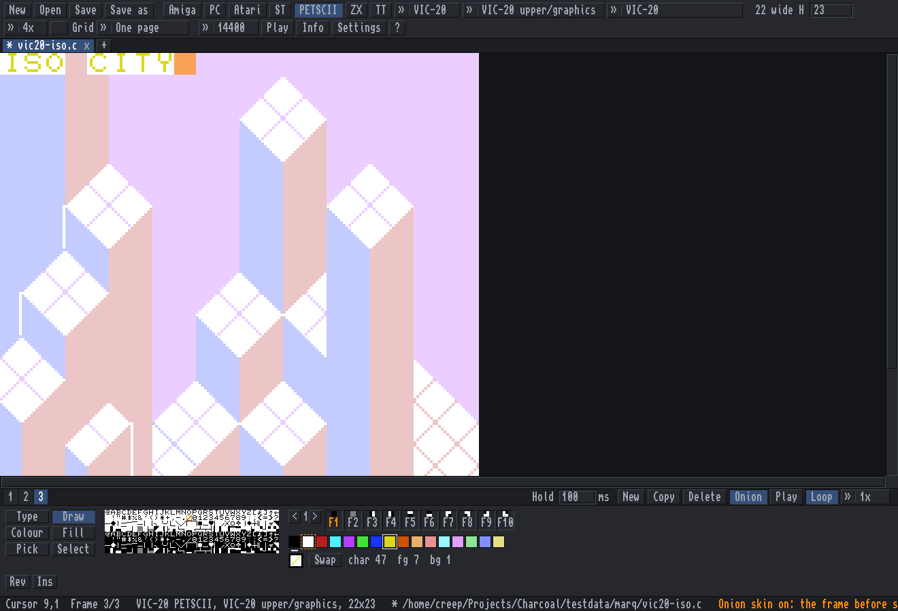
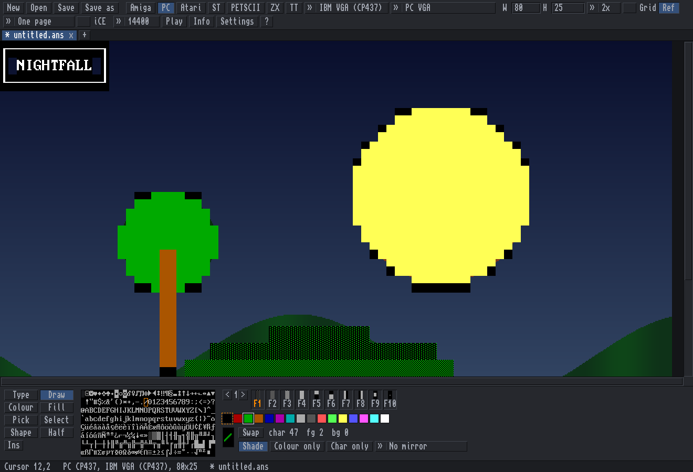
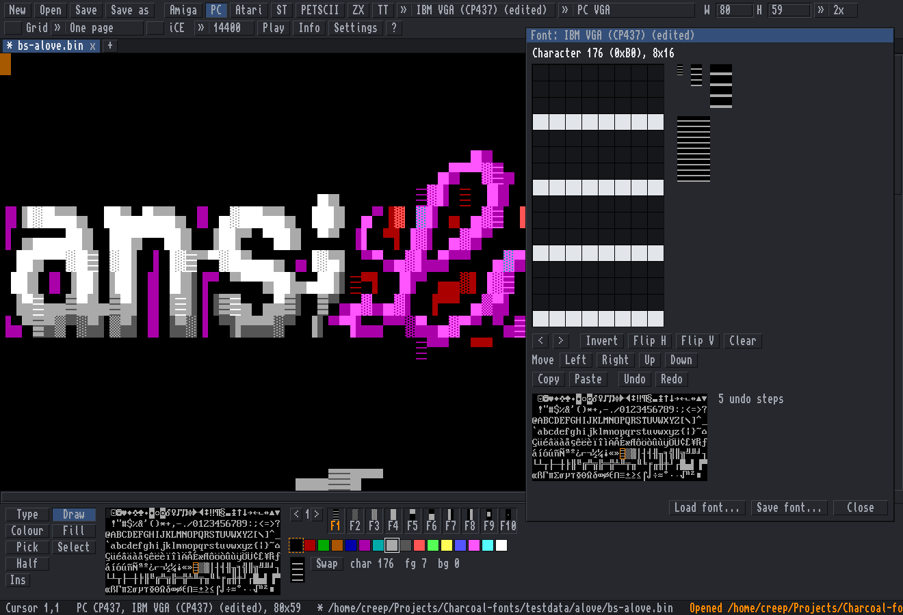
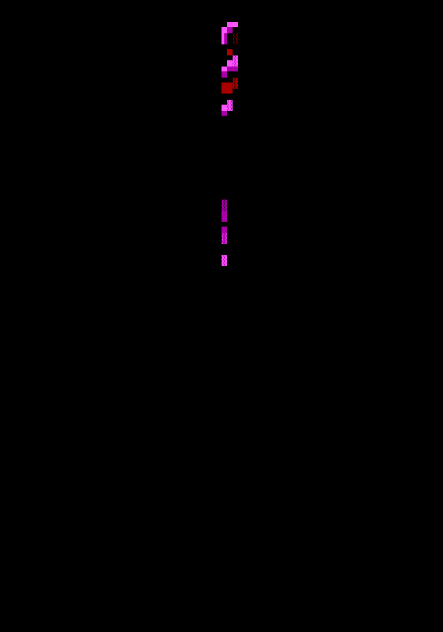

# Charcoal

Drawing with characters: **CharEdit**, the editor, and **CharView**, the viewer, for text art on every
platform: Amiga, PC, Commodore, Atari, Atari ST, ZX Spectrum and teletext, each with its real font, colours
and file formats.

*MiSTiGRiS 20th Anniversary* by Platinum / MiSTiGRiS (2014), from the mist1014 pack on 16colo.rs.

| | |
|---|---|
|  |  |
| Amiga page in Topaz 2+: *aBSiNTHE 40K* by aNACHRONiST / iMPURE!ASCII1940 (2022), impure81 on 16colo.rs. | C64 PETSCII with a block selected (Mirror, Upside down, Turn, Invert): *Uncle Nash*, an example picture from Marq's PETSCII editor. |
|  |  |
| Teletext (BBC Micro Mode 7 / Ceefax): *Rio*, an example page from QTeletextMaker. | Atari 8-bit ATASCII: *Turbo* (TEXTPIC1_CAR), from the ATASCII collection at breakintochat.com. |
|  |  |
| Tabs, and two pages side by side (Ctrl+L). | CharView, the viewer: *Jeroen Tel* by The Knight / Fuel (2019), fuel30 on 16colo.rs. |

The start screen: a new page for each machine, drawn in its own font and colours, and the recent files.

The art belongs to its artists and is shown here with their names; if you are one of them and want your
piece taken down, open an issue.

## Download

Get the newest version from the [releases page](https://github.com/creep-ltx/charcoal/releases): open
"Assets" under the top release and pick the zip for your computer. Unpack it (double-click the zip). Each
holds the program, this README, the licence and the font and library licences (`licences/`).

- **Windows** (10 or 11, 64-bit): `charcoal-windows-x64.zip`. Double-click `charedit.exe` to draw;
  `charview.exe` is the viewer (drop files or a folder on it). The first time, Windows may say
  *"Windows protected your PC"*, because the program is not signed: click **More info**, then **Run anyway**.
- **Mac** (macOS 11 or newer, Apple Silicon and Intel): `charcoal-macos.zip` holds **Charcoal.app**. Drag it to
  Applications. It is not signed by Apple, so the first double-click says it *"cannot be opened"* or that
  Apple *"could not verify"* it: click **Done**, open **System Settings > Privacy & Security**, scroll down and
  click **Open Anyway** next to Charcoal, then **Open**. (If it says the app *"is damaged"*, or there is no Open
  Anyway, type this in Terminal instead: `xattr -dr com.apple.quarantine /Applications/Charcoal.app`.) After that it opens like any program. Drop art files on its icon to open them.
  On a Mac, **Cmd** works wherever this README says Ctrl, Alt is the **left** Option key, and the **right**
  Option key types characters such as @ { [ | \. The viewer: `Charcoal.app/Contents/MacOS/charedit --view FILE`
  in Terminal.
- **Linux** (64-bit PC): `charcoal-linux-x64.zip`. It needs SDL2, which most desktops already have (if not:
  `sudo apt install libsdl2-2.0-0`, `sudo pacman -S sdl2` or `sudo dnf install SDL2`). Run `./charedit`;
  `charview` is a link to it.

Settings, keys and autosaves are kept in `%AppData%\Charcoal` on Windows,
`~/Library/Application Support/Charcoal` on a Mac and `~/.config/charcoal` + `~/.local/share/charcoal` on Linux.

## What it is

An art viewer and editor for Amiga ANSI, PC ANSI (and PCBoard, Avatar, XBin, iCEDraw, ArtWorx, TundraDraw),
Atari ATASCII, Atari ST VT52, Commodore PETSCII (PET, VIC-20, C64, C128), ZX Spectrum screens and teletext
(BBC Micro Mode 7, Ceefax), drawn with the real bitmap fonts: Topaz
1/1+/2/2+, MicroKnight, MicroKnight+, P0T-NOoDLE and mO'sOul on an Amiga page (Latin-1), IBM VGA, EGA 8x14,
VGA 8x8 (80x50) and the code pages 850 and 866 on a PC page (CP437), the C64's two character sets on a C64 page;
or a font of your own, drawn in its font editor.

    charedit [FILE...]     # the editor: its own window, one tab per file

    charview FILE|FOLDER...   # just looks: n / Right / Space next, p / Left previous, q / Esc quits

**CharView** is the same program started as `charview` (a link to `charedit`, or `charedit --view`): the art
fills the window, fitted to its width, with one line at the bottom (i hides it). Up/Down/PgUp/PgDn/Home/End
and the wheel scroll (Shift+Left/Right sideways), +/- zoom (0 fits again), g grid, m plays the file at modem
speed, e opens it in CharEdit. **a** scrolls by itself (tall art down, wide art sideways; at the end it waits two
seconds and goes to the next file), **s** switches smooth / a text row at a time, **[ ]** set the speed (0.5-48
rows a second); these are remembered. Art wider than the window is shown smaller (1/2, 1/3 ...; - and + step it), drawn once so scrolling stays
smooth. A folder gives every art file in it (.ans .asc .nfo .diz .txt .bin .seq
.pet .ice ...). It never changes the editor's other settings.

A native program (Go + SDL2, one binary; needs only the SDL2 library that every Linux desktop has). The whole
interface is drawn in Topaz, kept dark and small so the art comes first; **Ctrl+H** hides every gadget.
Press the **?** gadget for every key.

## Build

Working on Charcoal: start with [docs/HANDOFF.md](docs/HANDOFF.md) (state, wishes, testing) and
[docs/roadmap.md](docs/roadmap.md).

    go build -o charedit .     # needs Go and the SDL2 development files
    go test ./...             # the core: parser, writer, SAUCE

`~/.local/bin/charedit` and `~/.local/bin/charview` link to the binary here.

Windows and Mac programs are built by GitHub Actions (`.github/workflows/build.yml`) on every push, with SDL2
linked in so each is one file: Windows with the official SDL2 MinGW build, the Mac from SDL2's source as one
program for Apple Silicon and Intel, packed as `Charcoal.app` by `tools/release/package.sh`. Each run tests on
all three systems and keeps headless screenshots as artifacts. A tag `v*` makes a release (a prerelease if the
tag has a "b"). The Windows program also builds here, with MinGW and SDL2's MinGW package:

    CGO_ENABLED=1 GOOS=windows CC=x86_64-w64-mingw32-gcc CGO_CFLAGS=-I$SDL/include \
      CGO_LDFLAGS="-L$SDL/lib -lSDL2 -lsetupapi -lwinmm -limm32 -lversion -lole32 -loleaut32 -luuid -lgdi32 -luser32 -lshell32 -lcfgmgr32" \
      go build -ldflags '-s -w -H windowsgui -extldflags "-static"' -o charedit.exe .

(`$SDL` = `SDL2-x.y.z/x86_64-w64-mingw32` from `SDL2-devel-x.y.z-mingw.tar.gz`; Wine runs it.)

## What it does

- **Amiga page**: Latin-1, the 8-bit CSI byte 0x9B as well as `ESC [`, form feed clears the screen, LF line ends,
  italic (SGR 3) and underline (SGR 4) drawn like the Amiga console, bold as bright colours or as the console's
  smeared bold ("Bold smear"), 8×16 (line doubled) or 8×8.
- **PC page**: CP437 in the VGA font, CRLF line ends, blink or iCE colours, half-block painting, `.bin` files.
- Both: cursor movement, erase, insert/delete lines and characters, save/restore cursor, SyncTERM's font switch
  (`CSI 0;n SP D`), SAUCE read and written (width, font name, title, author, group, iCE flag). Amiga or PC is guessed
  from SAUCE and the bytes; "Open as" overrides. UTF-8 text files are read too.
- **Atari page**: ATASCII (`.ata`, and `.txt` files recognised by their bytes): inverse characters, one
  background and one text colour for the screen, border; EOL line ends, ESC before control characters, cursor
  moves for animations. Width 38 (the screen editor's margins) or 40 (terminals) is guessed: a 39-40 character
  line settles it, else the width where characters stack best. Checked on the Break Into Chat collection: all 203
  real files recognised, none of 853 ANSI/NFO files on this PC mistaken for ATASCII. The font is AltirraOS's
  (Altirra emulator, all-permissive licence, `fonts/AltirraOS-LICENSE.txt`), built in.
- A page has a real height (H): a file opens as tall as it is, its empty lines at the end included; the page
  ends where the dark area starts; every row is saved. Enter or Down past the last row adds a row.
- Pages for a machine's screen keep its width: PETSCII the machine's, Atari 38 or 40; only Amiga and PC pages
  can be any width (W).
- **PETSCII page** (the Machine gadget): PET 40/80 columns (green, amber or white screen), VIC-20 (22x23, 8 text
  colours), C64 (40x25; Pepto or Colodore colours), C128 40 columns, C128 80 columns (VDC, RGBI colours). Each
  machine's own character set, upper/graphics and lower/upper, from VICE (first run or Settings, 18 KB, SHA-1
  checked). Rendering checked against 125 pictures exported by Marq's PETSCII editor: all of the same version
  identical, cell by cell.
- **Atari ST page**: the ST's VT52 terminal in low (40x25, 16 colours), medium (80x25, 4) or high resolution
  (80x25, mono); each cell its own colours; `.vt` streams read and written, the resolution guessed from the pens
  and columns used. Font: EmuTOS's, downloaded on first use (GPL, so not built in), SHA-1 checked.
- **Teletext page**: 40x25 cells of 7-bit codes in 12x20 cells like the SAA5050's; attributes (text/graphics
  colour, double height, flash, conceal, separated, hold, new/black background) act from their cell on, read
  left to right as the chip reads a row (set-at / set-after as in ETS 300 706 and edit.tf). **Codes** shows the
  attributes' names; the **Sixel** tool paints a cell's 2x3 graphics pixels. Opens and saves `.tti`, `.ep1`,
  edit.tf links (`.url`; any text with an edit.tf link opens), opens BBC Mode 7 dumps (1000-byte `.bin`). Font:
  Bedstead (public domain), 5x9 dots doubled with the chip's character rounding (`tools/teletext-font.py`).
- **ZX Spectrum page**: the 32x24 screen, ink/paper/bright/flash per cell, the 48K ROM's font (built in: Amstrad
  allows passing the ROM on, `fonts/zx-spectrum-NOTICE.txt`) with the block graphics and UDGs. Saved as `.scr`
  (6912 bytes); a `.scr` opens with each 8x8 cell matched to a character (drawings get the nearest one).
- **PC BBS formats**: PCBoard `@X` (.pcb) and Avatar (.avt) open and save; iCEDraw (.idf), ArtWorx (.adf) and
  TundraDraw (.tnd) open with their own fonts and colours. The same art in five formats (ansilove's test files,
  `testdata/alove`) gives the same page in all of them. PC attribute bytes are in BIOS colour order and are
  converted.
- **C64 page**: PETSCII `.seq` files (the stream a C64 BBS sends): 40 columns, colour and reverse codes, both
  character sets, one screen colour, cursor moves, clear/home, insert/delete. The character set is the C64's
  ROM, not shipped: the first run offers to download it from the VICE emulator project (SourceForge, or its
  GitHub mirror), checked by SHA-1, into `~/.local/share/charcoal/chargen.bin`; Settings can do it too. bbmp's
  and an installed VICE's copies are used if present.
- **Tabs and two pages at once**: every file opens in a tab; show one page, two side by side or one over the other
  (Ctrl+L), optionally scrolling together.
- **Grid** (Ctrl+G, brighter every 10 columns and every 25 rows), **zoom** 1x-8x, fit to width (Ctrl+9),
  Ctrl+wheel zooms around the mouse.
- **Flip** a block left-right (Alt+H) or upside down (Alt+V): characters become their mirror images (known
  pairs first, then by comparing the glyphs' pixels, so it works in every font).
- Bottom strip: tools, all 256 characters (click = brush), 5 F-key sets (F1–F10), 16 colours (left fg, right bg,
  Shift+click edits the colour).
- Tools: Type, Draw (Shift+click = line), Colour, Fill, Pick (or middle click), Select (copy/cut/paste/stamp), Shape, Half.
- Undo/redo, play at modem speed; dropping a file on the window opens it.
- **Safety**: pages with changes are kept aside every two minutes and offered back after a crash; saving over a
  file keeps the old one as `name.bak` (Settings); the Open requester lists the last 10 files.
- **Save as**: ANSI, plain text, UTF-8, PC `.bin`, **XBin** (`.xb`, font and palette inside, so it looks the same in
  any viewer; opens again too), PETSCII `.seq`, a **C64 program** (`.prg`: LOAD and RUN on a C64 or in VICE, a key
  in Petmate's form, so Petmate and Marq's PETSCII editor open it too; any .prg in that form opens), the **C array** of Marq's PETSCII editor and Petmate (`.c`), a
  **Petmate workspace** (`.petmate`), **PNG**
  (normal or twice the size; C64 pages with their border) and a **web page** (`.html`). A typed file ending picks
  the format, and an **animated GIF or APNG** of the frames. Everything that holds characters opens too.
  (Web pages do not open; a picture can be the page's reference, below.)
- Settings in `~/.config/charcoal/prefs.json` (`"uiscale": 2` doubles the window for big screens).

## Frames and animation

A page can hold several frames. Alt+N adds an empty one, Ctrl+Shift+D copies the frame, Alt+, and Alt+. (or
Alt+PgUp / PgDn) go through them, Alt+Delete deletes one. The **strip** under the page numbers them (click to go,
drag to move) with each frame's **hold** time, and New, Copy, Delete, **Onion** (the frame before, faint, under the
empty cells; Alt+O), **Play** (Ctrl+P, at 1/2x to 4x, looping or once). Undo covers all of it.

- A `.c` or `.petmate` with several screens opens as frames and saves them all (Petmate's own fields, fonts and
  screen names kept); a teletext `.tti` carousel opens a frame per subpage and saves every line but the changed
  rows, its CT line as the hold.
- An ANSI, PETSCII, ATASCII or VT52 file that clears the screen between pictures (an ANSImation) opens as its last
  picture and says how many it shows: Ctrl+Shift+F shows the strip with **Split** (at each clear, or at each cursor
  home). Saved, the frames are one stream with a clear between them; their hold times come from the modem speed.
- Save as **Animation (.gif)** or **Animation, APNG (.png)** writes every frame for its hold time. A format that
  holds one picture (`.scr`, `.png`, `.xb` ...) writes the frame on show and says the others are only in CharEdit.

## Reference picture, shapes and brushes

- **Reference picture** to trace over (the **Ref** gadget, Ctrl+Shift+I, or drop a PNG, JPEG, GIF, BMP or WebP on
  the window): it shows in the empty cells, or faintly over everything; fainter / stronger (Ctrl+[ / Ctrl+]),
  hide (Ctrl+Shift+R), greys, move (Ctrl+Shift+M then drag or arrows, or Ctrl+drag), size (fit width, fit page,
  1:1, bigger, smaller). Only shown: never turned into characters, never saved or exported. It is remembered with
  the art file (`prefs.json` `references`) and in the autosave.
- **Shape** tool: line, box or ellipse, dragged, outlined or filled (Shift at the press, or Filled); in the brush,
  in box-drawing lines (PC single or double, PETSCII and Atari lines) or in half blocks (PC; sixels on teletext).
  Right button erases. One undo step each.
- **Shade** brush (Draw): left steps a cell up the shades, right down (PC: empty, the three shade blocks, the full
  block; PETSCII: the checkerboard, then reversed; other pages a short ASCII ramp). Each page type's own sequence
  can go in `prefs.json`, e.g. `"shades": {"amiga": [32, 46, 58, 43, 35]}`.
- **Mirror**: what Draw, Colour, Half and Shape put down is mirrored left-right and/or top-bottom around the page's
  centre, characters as their mirror twins.
- **Colour only / Char only**: Draw and Shape paint just the colours or just the characters.
- These options sit under the brush while a drawing tool is in use.

## Fonts

- **Built-in PC fonts**: IBM VGA, EGA 8x14, VGA 8x8 (80x50 pages), VGA with code page 850 and 866, from VileR's
  *Ultimate Oldschool PC Font Pack*. A SAUCE font name (`IBM VGA`, `IBM EGA`, `IBM VGA50`, `IBM EGA43`,
  `IBM VGA 850` ...) picks the font when a file opens; saving writes the font's name.
- **Your own font** for a page: the Font gadget's *Load a font...* (Ctrl+Shift+L), or drop the file on the window
  (it asks: font or art?). PC raw fonts (`.fnt .f08 .f14 .f16`: 256 characters of 8, 14 or 16 rows), PSF 1 and 2,
  an XBin's font; C64, VIC-20 and PET character sets (`.64c` with its load address, `.bin` of 2048 bytes a set or
  4096 for both); Atari 8-bit `.fnt` (1024 bytes); ZX Spectrum sets (768 bytes, codes 32-127) and UDGs
  (168 bytes). The font is named after its file.
- **Kept with the art**: XBin holds the font inside, a Petmate workspace as its custom font (Petmate reads it).
  Formats that cannot hold a font (ANSI, `.seq`, `.ata`, `.scr`, `.prg` ...) say so when saved, and CharEdit
  remembers the font for that file: it comes back when the file opens again. Autosaves keep it too.
- **Font editor** (Ctrl+Shift+E, or *Edit the font...*): the brush character's pixels in a grid. Click or drag
  sets pixels (a set pixel clicked clears), right click clears; Invert, Flip, Move (Shift+arrows), Clear, Copy,
  Paste, Undo; arrows or the character map pick another character. The page shows every change at once. Editing a
  built-in font makes a copy, the page's own. *Save font...* writes it as `.psf`, `.f08/.f14/.f16`, `.64c`, `.fnt`,
  `.ch8` or `.udg`.

## Animation templates

TheDraw 4.63 could turn any finished screen into an animation by drawing it cell by cell in a pattern. CharEdit
does the same (Alt+J, **Animate**): TheDraw's fourteen patterns (Top, Left, Clock, Circles, Checkerboard, Angle,
Gate, Pyramid, Squares, Scramble, Door, Diamond, Wiggle, Wiggle out) with its two toggles **Reverse** and **Flip**,
and Charcoal's own: Fade in / out through the palette, Typewriter, Scroll in, and ten more:

| Template | What it does |
|---|---|
| Matrix rain | in every column a stream of changing glyphs falls (bright head, darker trail; reverse where the page has no colours to spare) and leaves the picture behind; columns start at random times |
| Decrypt | every cell shows random glyphs until it locks to its own character with a flash, sweeping left to right, ragged |
| Spiral | a draw order: clockwise from the outer edge inwards |
| Drop | every character falls from the top row to its place, faster and faster, columns filling from the bottom in a wave |
| Assemble | every character flies in a straight line from a random place to its own, slowing down as it lands |
| Blinds | a draw order: venetian blinds, bands of four rows opening at the same time |
| Shine | a slanted band of light passes once over the finished picture, a logo's glint |
| Shade in | every cell comes up through the page's shade steps (PC: light, medium, dark shade) to its own character |
| Melt in | Doom's screen melt the other way round: the columns slide down into place, each a little behind or ahead of its neighbour |
| Power on | a television switched on: a bright line grows across the middle, then opens up and down, its edges bright |

Each keeps its page's rules: teletext codes stay where they are, Spectrum ink and paper share their brightness, the
Atari 8-bit, PET and ST high resolution use reverse. Random parts come from a seed kept with the page (Shuffle or
S picks another), so saving twice gives the same file. A preview plays the effect at its own speed.

- **Draw order**: saving as `.ans`, `.seq`, `.ata` or `.vt` writes the picture in that order: a clear screen, then
  each cell with a cursor move where it does not follow the one before (ANSI `ESC[row;colH`, PETSCII cursor keys
  and HOME, ATASCII cursor keys, VT52 `ESC Y`), colours only where they change, empty cells left out. Any BBS
  terminal plays it at modem speed; opened again it is exactly the same picture. The order stays with the page
  until changed or cleared; Ctrl+P (and CharView's `m`) plays it. The frame effects (Matrix rain, Decrypt, Drop,
  Assemble, Shine, Shade in, Melt in, Power on) save as a **delta stream**: the clear screen, then each frame's
  changed cells only (the same cursor moves and colours); the modem's speed is the pace, unless BBS pauses are on.
- **Frames**: one every N cells (or every N ms at the modem speed), for the strip, Play, GIF and APNG. Erase makes
  the picture go away instead (TheDraw's Fadeout). Teletext and Spectrum pages make frames only.

### BBS pauses

A modem was the pace: over telnet with no speed limit an animated file arrives at once and the effect flashes past.
Many BBSes read a pause code of their own while they show a screen, so CharEdit can write that board's codes into
the saved `.ans`: a pause every N cells of a draw order, after every frame of a frame effect, or each frame's hold
for the frame strip. **Settings > My BBS** (default *none*) is used for every animated file you save; **Animate**
shows it and can choose another board, or none, for one page (kept with the page's order), and can save one copy
per board in one go beside the file (`name-amiexpress.ans`, `name-mystic.ans` ...). *None* is the safe choice for
art packs, 16colo.rs and several boards: another board's codes show as junk text. The board takes the codes out,
so the terminal gets exactly the plain file's bytes (tested through a model of each board's display code).

| Board | Written first | Pause | Unit, most per code | The board's own character in the art | How known |
|---|---|---|---|---|---|
| Ami-Express (/X) 5 | `~NS\|` (the first byte must be `~`; no More?) | `~<n>w\|` | 1/50 s, 999 | `~` as `~~\|`; codes never cut by its 998-byte reads | source |
| Mystic | `\|PO` (no More?) | `\|DE` | 0.5 s, fixed | `\|` as `\|PI` | source (1.10) + docs |
| PCBoard 15 | `@POFF@` (no More?) | `@DELAY:n@` | 0.1 s, 255 | none exists; codes never cut by its 2047-byte lines | source |
| Synchronet | | Ctrl-A `,` `;` `.` | 0.1 / 0.5 / 2 s | Ctrl-A as Ctrl-A `A`, Ctrl-Z as Ctrl-A `z`; Ctrl-A `Q` after `@`, `\|` and LF | source |
| Tempest | | `~DELAY(n)` | 1/50 s | `~` as `~~` | manual only |

Not offered: boards with no fixed delay code (System-X, Sigma Express, DayDream, ENiGMA½, Talisman, Wildcat,
Logic), with only whole seconds (FAME `~W`, CNet `{W}`, Image BBS `£W`) or a fixed 0.8 s (Renegade `%DE`,
Telegard `@8`), Hydra (its timed pause shows a prompt) and Ami-Express 4.x (its manual has no `~w`). PETSCII,
ATASCII and VT52 files get no codes.

## Keys

Every shortcut can be changed in `~/.config/charcoal/keys` (`action = key, key`; written with the defaults and
comments on the first start; a line it cannot read is skipped and named in the status line). Alt is the left Alt
only (the right one is AltGr). Fixed: typing, F1-F10 (the F-key set), the cursor keys, Return, Tab, Backspace,
Delete, Insert, Esc. The defaults, the PC ANSI editors' (Moebius, PabloDraw, TheDraw) where they agree:

| Keys | Action |
|---|---|
| Ctrl+O, Ctrl+Shift+O | open, open the most recent file again |
| Ctrl+S, Ctrl+Shift+S, Ctrl+I | save, save as, info (SAUCE) |
| Ctrl+T / Ctrl+N, Ctrl+W, Ctrl+Tab / Ctrl+Shift+Tab (Ctrl+PgDn / PgUp) | new page, close page, next / previous page |
| Ctrl+L, Ctrl+Q | one page / side by side / top and bottom, quit |
| Ctrl+Z, Ctrl+Y / Ctrl+Shift+Z | undo, redo |
| Ctrl+A, Ctrl+C, Ctrl+X, Ctrl+V | select all, copy, cut, paste |
| Shift+arrows / Home / End / PgUp / PgDn | select from the cursor (any tool); Esc lets go |
| Alt+H, Alt+V, Alt+R, Alt+I | mirror, upside down, turn, invert the block (nothing selected: H/V/R turn the brush character) |
| Alt+F, Ctrl+K | fill the selection with the brush (nothing selected: Fill tool), crop to the selection (Amiga, PC) |
| Ctrl+Home, Ctrl+End | top, bottom of the page |
| Alt+Up / Alt+Down, Alt+Left / Alt+Right | delete / insert a row, delete / insert a column |
| Alt+T, D, K, L, P, S, B | tools: Type, Draw, Colour, Fill, Pick, Select, Half (PC) / Sixel (teletext) |
| Ctrl+Up / Ctrl+Down, Ctrl+Left / Ctrl+Right | foreground -/+, background -/+ |
| Ctrl+0-7, Alt+0-7 | foreground, background colour (again: the bright one) |
| Alt+U, Ctrl+D, Ctrl+Shift+X, Ctrl+E | take the colours under the cursor, default colours, swap, iCE on/off |
| Ctrl+F1-F10, Ctrl+Shift+Up / Down | F-key set 1-10, next / previous set |
| Ctrl+= / Ctrl++, Ctrl+-, Ctrl+9 | zoom in, out, fit the width |
| Ctrl+G, Ctrl+R, Ctrl+H | grid, reverse (PETSCII, Atari), hide the gadgets |
| Alt+N, Ctrl+Shift+D, Alt+Delete | new frame, copy the frame, delete it |
| Alt+, / Alt+. (Alt+PgUp / PgDn), Alt+Home / End | previous / next frame, first / last |
| Alt+Shift+PgUp / PgDn, Alt+[ / Alt+] | move the frame earlier / later, hold it shorter / longer |
| Ctrl+P, Alt+O, Ctrl+Shift+F | play the frames, onion skin, show / hide the frame strip |
| Alt+Shift+L, R, O; Alt+Shift+F, B | Shape tool: line, box, ellipse; filled, style (brush / lines / half blocks) |
| Alt+Shift+S, Alt+Shift+H / V, Alt+Shift+K / C | shade brush, mirror left-right / top-bottom, colour only / character only |
| Ctrl+Shift+I, Ctrl+Shift+R, Ctrl+[ / Ctrl+], Ctrl+Shift+M, Ctrl+Alt+= / - | reference: open, show / hide, fainter / stronger, move, bigger / smaller |

Dragging inside a selection with the Select tool moves it (one undo step).

## Tested

`bigcheck_test.go` (see `tools/bigcheck/`) runs thousands of real files: on 2026-10-13, 4119 files from 16colo.rs
(PC, Amiga, XBin, PETSCII-style and animation packs), C64 BBS `.seq` files, Petmate `.petmate`/`.c` files from
GitHub and the Break Into Chat ATASCII collection. All open, all with a known type get the right page type, all
come back cell for cell after saving in their own format.

## Files

| Path | What |
|---|---|
| `core.go` | document, ANSI parser, writer, SAUCE (no window; `core_test.go`) |
| `editor.go` | the editor's state and editing, loading, saving, playing |
| `view.go` | the main window: gadget bar, page, bottom strip, status line |
| `dialogs.go` | open/save, info, colour, help, yes/no requesters |
| `ui.go`, `gfx.go` | the gadgets and the pixel drawing |
| `fonts.go`, `fonts/` | the embedded fonts and their mirror tables; `cp437.go` the CP437 table |
| `fontfile.go`, `fontedit.go` | a page's own font: font files read and written, kept with the art; the font editor (`fontfile_test.go`); `tools/pcfonts.py` makes the built-in EGA/VGA fonts |
| `viewer.go` | CharView |
| `export.go` | `.prg`, the `.c` array, XBin, HTML (`export_test.go` runs the `.prg` in a small 6502 emulator) |
| `atari.go` | ATASCII: the Atari fonts, `.ata` reader and writer, recognising and width guessing (`atari_test.go`) |
| `pet.go` | PETSCII: the C64 fonts, the `.seq` reader and writer, typing (`pet_test.go`) |
| `keys.go` | the table of actions and their default keys, the keys file, the help's key list |
| `rowscols.go`, `blockjobs.go` | insert/delete rows and columns; fill, move and crop a block |
| `frames.go`, `strip.go`, `streams.go` | frames and their undo, the frame strip and onion skin, cutting streams into frames |
| `anim.go`, `apng.go` | GIF and APNG export |
| `autosave.go` | autosave and offering it back, `.bak` on save, recent files |
| `paths.go`, `keymods.go`, `platform_*.go` | per system: the settings and data folders, Cmd and AltGr, drives, is a CharEdit still running |
| `script.go` | `CHARCOAL_SCRIPT` test steps, for checking it headless with `SDL_VIDEODRIVER=offscreen` |
| `web/` | the first version, called amiansi, that ran in the browser (Python server + HTML/JS), kept for reference |

## Licences

Charcoal's own code is under the MIT licence (`LICENSE`), copyright Tobias Karlsson. These parts keep theirs:

| Part | From | Licence |
|---|---|---|
| Amiga fonts (Topaz 1/1+/2/2+, MicroKnight/+, P0T-NOoDLE, mO'sOul) | TrueSchool's *Multi Platform Amiga Fonts* raw conversions, dMG/t!s^dS!, github.com/rewtnull/amigafonts (256 glyphs × 16 rows, each row of the 8×8 original doubled) | GPL with the font exception, `fonts/amigafonts-NOTICE.txt` |
| IBM VGA 8×16 | rendered from Px437_IBM_VGA_8x16, VileR, *The Ultimate Oldschool PC Font Pack* | CC BY-SA 4.0, `fonts/Px437-LICENSE.TXT` |
| IBM EGA 8×14, IBM VGA 8×8, IBM VGA 8×16 code pages 850 and 866 (`fonts/IBM_*.f08/.f14/.f16`) | drawn from Bm437_IBM_EGA_8x14, Bm437_IBM_VGA_9x8 and BmPlus_IBM_VGA_8x16, VileR, *The Ultimate Oldschool PC Font Pack* v2.2 (int10h.org), by `tools/pcfonts.py` | CC BY-SA 4.0, `fonts/Px437-LICENSE.TXT` (the pack's licence) |
| Atari 8-bit fonts | AltirraOS, from the Altirra emulator | all-permissive, `fonts/AltirraOS-LICENSE.txt` |
| ZX Spectrum font | the 48K ROM's character set | © Amstrad, who allow passing it on, `fonts/zx-spectrum-NOTICE.txt` |
| Teletext font | Bedstead, Ben Harris | CC0, `fonts/bedstead-NOTICE.txt` |
| PETSCII flip and turn tables (`cbmturn.go`) | Marq's PETSCII editor, Marq / Fit^L!T, tables by Dr. TerrorZ | WTFPL, `third_party/marq-petscii-LICENSE.txt` |
| Petmate's file formats | Petmate, C. T. Lin | MIT, `third_party/petmate-LICENSE.txt` |
| SDL2 (linked into the Windows and Mac programs) | libsdl.org, Sam Lantinga | zlib, `third_party/SDL2-LICENSE.txt` |
| go-sdl2, the Go binding to SDL2 | github.com/veandco/go-sdl2 | BSD 3-clause, `third_party/go-sdl2-LICENSE.txt` |
| BMP and WebP readers (reference pictures) | golang.org/x/image, The Go Authors | BSD 3-clause, `third_party/x-image-LICENSE.txt` |
| Test art in `testdata/alove` | ansilove's tests | BSD 2-clause, `testdata/alove/LICENSE-ansilove.txt` |

Not included, fetched on first use and checked by SHA-1: the Commodore character ROMs (from the VICE
project) and the EmuTOS font sources (GPL), for PETSCII and Atari ST pages.
