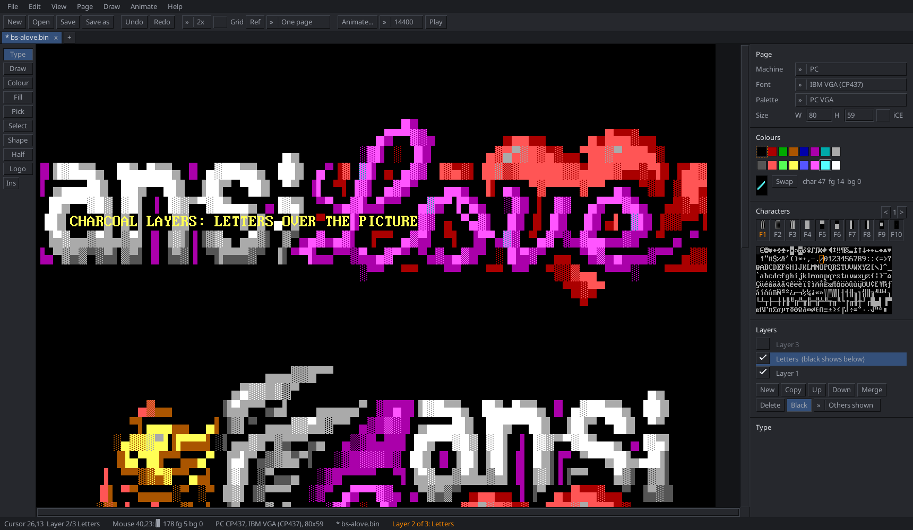
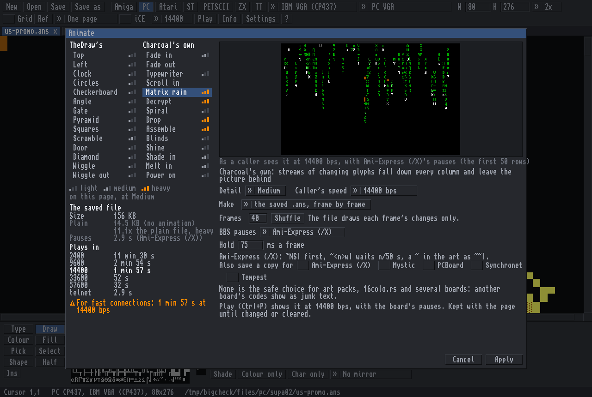
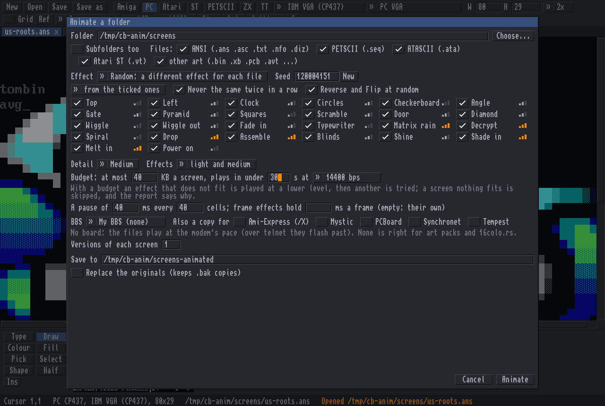

# Charcoal

Drawing with characters: **CharEdit**, the editor, and **CharView**, the viewer, for text art on every
platform: Amiga, PC, Commodore, Atari, Atari ST, ZX Spectrum, Amstrad CPC, MSX, Sharp MZ-700, teletext, Viewdata and Minitel, each with its real font, colours
and file formats.


<sub>*MiSTiGRiS 20th Anniversary* by Platinum / MiSTiGRiS (2014), from the mist1014 pack on 16colo.rs.</sub>

| | |
|---|---|
|  |  |
| <sub>Amiga page in Topaz 2+, the Workbench theme, the Animate menu open: *aBSiNTHE 40K* by aNACHRONiST / iMPURE!ASCII1940 (2022), impure81 on 16colo.rs.</sub> | <sub>C64 PETSCII with a block selected (Mirror, Upside down, Turn, Invert): *Uncle Nash*, an example picture from Marq's PETSCII editor.</sub> |
|  |  |
| <sub>Teletext (BBC Micro Mode 7 / Ceefax): *Rio*, an example page from QTeletextMaker.</sub> | <sub>Atari 8-bit ATASCII: *Turbo* (TEXTPIC1_CAR), from the ATASCII collection at breakintochat.com.</sub> |
|  |  |
| <sub>Tabs, and two pages side by side (Ctrl+L).</sub> | <sub>CharView, the viewer: *Jeroen Tel* by The Knight / Fuel (2019), fuel30 on 16colo.rs.</sub> |
|  |  |
| <sub>The Light theme: *Jeroen Tel* by The Knight / Fuel (2019), fuel30 on 16colo.rs.</sub> | <sub>The Focus layout (the page as wide as the window, the gadgets under it) on a teletext page: *Rio*, from QTeletextMaker.</sub> |


<sub>The start screen: a new page for each machine, drawn in its own font and colours, and the recent files.</sub>

The art belongs to its artists and is shown here with their names; if you are one of them and want your
piece taken down, open an issue.

## Download

What is new in each version: [CHANGELOG.md](CHANGELOG.md) (each release page says the same).

Get the newest version from the [releases page](https://github.com/creep-ltx/charcoal/releases): open
"Assets" under the top release and pick the zip for your computer. Unpack it (double-click the zip). Each
holds the program, this README, the licence and the font and library licences (`licences/`).

- **Windows** (10 or 11, 64-bit): `charcoal-windows-x64.zip`. Double-click `charedit.exe` to draw;
  `charview.exe` is the viewer (drop files or a folder on it). The first time, Windows may say
  *"Windows protected your PC"*, because the program is not signed: click **More info**, then **Run anyway**.
- **Mac** (macOS 11 or newer, Apple Silicon and Intel): `charcoal-macos.zip` holds **Charcoal.app**. Drag it to
  Applications. It is not signed by Apple, so the first double-click says it *"cannot be opened"* or that
  Apple *"could not verify"* it: click **Done**, open **System Settings > Privacy & Security**, scroll down and
  click **Open Anyway** next to Charcoal, then **Open**. (If it says the app *"is damaged"*, or there is no Open
  Anyway, type this in Terminal instead: `xattr -dr com.apple.quarantine /Applications/Charcoal.app`.) After that it opens like any program. Drop art files on its icon to open them.
  On a Mac, **Cmd** works wherever this README says Ctrl, Alt is the **left** Option key, and the **right**
  Option key types characters such as @ { [ | \. The viewer: `Charcoal.app/Contents/MacOS/charedit --view FILE`
  in Terminal.
- **Linux** (64-bit PC): `charcoal-linux-x64.zip`. It needs SDL2, which most desktops already have (if not:
  `sudo apt install libsdl2-2.0-0`, `sudo pacman -S sdl2` or `sudo dnf install SDL2`). Run `./charedit`;
  `charview` is a link to it.

Settings, keys and autosaves are kept in `%AppData%\Charcoal` on Windows,
`~/Library/Application Support/Charcoal` on a Mac and `~/.config/charcoal` + `~/.local/share/charcoal` on Linux.

## What it is

An art viewer and editor for Amiga ANSI, PC ANSI (and PCBoard, Avatar, the BBS colour codes of Mystic,
Renegade, Synchronet, WWIV, Wildcat!, Celerity and Telegard, XBin, iCEDraw, ArtWorx, TundraDraw, IcyDraw, REXPaint, Playscii),
Unicode terminal art (UTF-8 ANSI in 256 and 24-bit colours, durdraw) and IRC art (mIRC colour codes),
Atari ATASCII, Atari ST VT52 and IGS, Commodore PETSCII (PET, VIC-20, C64, C128), ZX Spectrum screens, Amstrad CPC
text art (AMSCII), MSX (SCREEN 0 and 1), Sharp MZ-700, teletext (BBC Micro Mode 7, Ceefax), Viewdata (Prestel, Telstar) and Minitel (Videotex `.vdt`), drawn with the real bitmap fonts: Topaz
1/1+/2/2+, MicroKnight, MicroKnight+, P0T-NOoDLE and mO'sOul on an Amiga page (Latin-1), IBM VGA, EGA 8x14,
VGA 8x8 (80x50) and the code pages 850 and 866 on a PC page (CP437), the C64's two character sets on a C64 page;
or a font of your own, drawn in its font editor.

    charedit [FILE...]     # the editor: its own window, one tab per file

    charview FILE|FOLDER...   # just looks: n / Right / Space next, p / Left previous, q / Esc quits

**CharView** is the same program started as `charview` (a link to `charedit`, or `charedit --view`): the art
fills the window, fitted to its width, with one line at the bottom (i hides it). Up/Down/PgUp/PgDn/Home/End
and the wheel scroll (Shift+Left/Right sideways), +/- zoom (0 fits again), g grid, m plays the file at modem
speed, e opens it in CharEdit. **a** scrolls by itself (tall art down, wide art sideways; at the end it waits two
seconds and goes to the next file), **s** switches smooth / a text row at a time, **[ ]** set the speed (0.5-48
rows a second); these are remembered. Art wider than the window is shown smaller (1/2, 1/3 ...; - and + step it), drawn once so scrolling stays
smooth. A folder gives every art file in it (.ans .asc .nfo .diz .txt .bin .seq
.pet .ice ...). It never changes the editor's other settings.

A native program (Go + SDL2, one binary; needs only the SDL2 library that every Linux desktop has). Every
command is in the menu bar (File, Edit, View, Page, Draw, Animate, Help) with its keys beside it; one toolbar
row holds the everyday ones. Two layouts (View menu or Settings): **Studio**, the tools in a rail on the left and
the page's settings, colours, characters and the tool's options in a panel on the right, and **Focus**, the page
as wide as the window with the gadgets under it. Three themes: **Dark**, **Light** and **Workbench**. The
interface text is the system's font by default, or the Go font, Topaz, or any .ttf / .otf, in sizes 11 to 20
(Settings); the art always keeps its own fonts. **Ctrl+H** hides every gadget. **Help > Keys and mouse** (F12)
lists every key.

## Build

Working on Charcoal: start with [docs/HANDOFF.md](docs/HANDOFF.md) (state, wishes, testing) and
[docs/roadmap.md](docs/roadmap.md).

    make                      # builds charedit; needs Go and the SDL2 development files
    sudo make install         # charedit, charview, menu entries and icon under /usr/local
    make test                 # the core: parser, writer, SAUCE

The SDL2 development files are `libsdl2-dev` (Debian, Ubuntu), `sdl2` (Arch) or `SDL2-devel` (Fedora).
`make install PREFIX=$HOME/.local` installs for one user without root (`~/.local/bin` must be on `PATH`);
`make uninstall` with the same `PREFIX` removes it again, and `DESTDIR` is for packagers. Install puts
`charedit` in `bin` with `charview` as a link to it, CharEdit in the desktop's application menu, and CharView
as an "Open with" choice for art files (it is not in the menu, since it needs a file to show). Plain
`go build -o charedit .` still works and leaves the program here.

Windows and Mac programs are built by GitHub Actions (`.github/workflows/build.yml`) on every push, with SDL2
linked in so each is one file: Windows with the official SDL2 MinGW build, the Mac from SDL2's source as one
program for Apple Silicon and Intel, packed as `Charcoal.app` by `tools/release/package.sh`. Each run tests on
all three systems and keeps headless screenshots as artifacts. A tag `v*` makes a release (a prerelease if the
tag has a "b"). The Windows program also builds here, with MinGW and SDL2's MinGW package:

    CGO_ENABLED=1 GOOS=windows CC=x86_64-w64-mingw32-gcc CGO_CFLAGS=-I$SDL/include \
      CGO_LDFLAGS="-L$SDL/lib -lSDL2 -lsetupapi -lwinmm -limm32 -lversion -lole32 -loleaut32 -luuid -lgdi32 -luser32 -lshell32 -lcfgmgr32" \
      go build -ldflags '-s -w -H windowsgui -extldflags "-static"' -o charedit.exe .

(`$SDL` = `SDL2-x.y.z/x86_64-w64-mingw32` from `SDL2-devel-x.y.z-mingw.tar.gz`; Wine runs it.)

## What it does

- **Amiga page**: Latin-1, the 8-bit CSI byte 0x9B as well as `ESC [`, form feed clears the screen, LF line ends,
  italic (SGR 3) and underline (SGR 4) drawn like the Amiga console, bold as bright colours or as the console's
  smeared bold ("Bold smear"), 8×16 (line doubled) or 8×8.
- **PC page**: CP437 in the VGA font, CRLF line ends, blink or iCE colours, half-block painting, `.bin` files.
- Both: cursor movement, erase, insert/delete lines and characters, save/restore cursor, SyncTERM's font switch
  (`CSI 0;n SP D`), SAUCE read and written (width, font name, title, author, group, iCE flag). Amiga or PC is guessed
  from SAUCE and the bytes; "Open as" overrides. UTF-8 files are read too, and Save writes them in UTF-8 again
  ("ANSI in UTF-8, for terminals": every row in full and ended by LF, no SAUCE record, as Moebius's UTF-8 export
  and durdraw write them), so a terminal artist's file stays readable with `cat`.
- **Atari page**: ATASCII (`.ata`, and `.txt` files recognised by their bytes): inverse characters, one
  background and one text colour for the screen, border; EOL line ends, ESC before control characters, cursor
  moves for animations. Width 38 (the screen editor's margins) or 40 (terminals) is guessed: a 39-40 character
  line settles it, else the width where characters stack best. Checked on the Break Into Chat collection: all 203
  real files recognised, none of 853 ANSI/NFO files on this PC mistaken for ATASCII. The font is AltirraOS's
  (Altirra emulator, all-permissive licence, `fonts/AltirraOS-LICENSE.txt`), built in. With a real Atari OS ROM
  on this computer (`ATARIXL.ROM` or `ATARIOSB.ROM` in CharEdit's data folder, `~/.atari800` or
  `/usr/share/atari800`; Atari's ROMs may not be passed on, so CharEdit brings none) the Font gadget also offers
  "Atari (OS ROM)" and the XL's international set. Own fonts: Load a font (`.fnt`, 1024 bytes), the font editor.
  Colours are the machine's registers, from GTIA's 128 colours (Palette: Atari PAL or NTSC, Altirra's or atari800's): text
  (COLOR1, 709: only its luminance counts, the text takes the screen's hue, as in GRAPHICS 0), screen (COLOR2,
  710) and border (COLOR4, 712); left / right / middle click in the 16 x 8 colour grid, the values to poke shown
  under it. Start-up colours 202 on 148, border 0. The default colours are Altirra's PAL palette (what compo screenshots
  are taken with); Altirra's NTSC and atari800's PAL and NTSC palettes are in the Palette gadget.
  **Runs on the machine**: `.xex` (a program for any Atari 400/800/XL/XE: the page in its colours, with its own
  font when it has one; DOS, a loader or an emulator runs it) and `.atr` (a single density disk that boots straight
  into it). Both open again. The first 24 rows are shown; a 38-wide page sits at the screen editor's column 2.
- A page has a real height (H): a file opens as tall as it is, its empty lines at the end included; the page
  ends where the dark area starts; every row is saved. Enter or Down past the last row adds a row.
- Pages for a machine's screen keep its width: PETSCII the machine's, Atari 38 or 40; only Amiga, PC and Unicode
  pages can be any width (W).
- **PETSCII page** (the Machine gadget): PET 40/80 columns (green, amber or white screen), VIC-20 (22x23, 8 text
  colours), C64 (40x25; Pepto or Colodore colours), C128 40 columns, C128 80 columns (VDC, RGBI colours), Plus/4,
  DirArt (below).
  Each machine's own character set, upper/graphics and lower/upper, from VICE (first run or Settings, 34 KB, SHA-1
  checked). Rendering checked against 125 pictures exported by Marq's PETSCII editor: all of the same version
  identical, cell by cell.
- **Plus/4 page** (also the C16 and C116; the Plus/4 start tile, or Model: Plus/4): 40x25 like the C64, but
  every cell has the TED's whole attribute: one of 16 hues in 8 luminances (121 colours, black has no
  luminance) and **Flash** (the tool rail's toggle; flashing cells blink on the page). The screen colour and the
  border are TED colours too; a new page has the Plus/4's power-on colours (black on white, a light blue
  border). The Colours panel is the hue x luminance grid (left: the brush, right: the screen colour, middle:
  the border; the wheel over it makes the brush lighter or darker, as in Marq's PETSCII editor); Ctrl+0-7 and
  Ctrl+arrows change the hue and keep the luminance. Palettes: VICE's own (the default: VICE 3.9's xplus4
  shows exactly these), YAPE's and Colodore's (VICE's `.vpl` files). The character set is the Plus/4 ROM's
  (from VICE, like the other Commodore ROMs). Files: **`.prg`** (Marq's PETSCII editor's Plus/4 program: `RUN`
  shows the page; checked in VICE's xplus4: its screenshot and CharEdit's PNG are identical, pixel for pixel,
  border included), a **`.d64`** holding it, **`.scrn`** (TED Screen Editor's screen, with its `.proj` for the
  size and colours, written next to it), Marq's **`.c`** (`PLUS4`), Petmate9's **`.petmate`** (`c16Upper` /
  `c16Lower` screens), Marq's BASIC listing and ACME source (both also checked in xplus4), **`.seq`** as a Plus/4 prints it (the colour codes give the KERNAL's luminance of each
  hue, FLASH ON / OFF are 0x82 / 0x84; the save says how many cells show another luminance), PNG / GIF / APNG
  as VICE's screenshots (384x288, the screen at 32,40). Open as "Plus/4 PETSCII" reads any file as a Plus/4
  prints it; changing a page between the C64 and the Plus/4 turns its colours into the nearest (Ctrl+Z
  undoes it). **A character set of its own** (Load a font..., or the font editor; TED Screen Editor's `.chrs`,
  `.64c`, `.bin` of 1024 bytes for 128 characters or 2048 for 256): the font editor changes a character and its
  reverse together, as the TED shows them. It goes with the page in CharEdit's own Plus/4 `.prg` (and `.d64`:
  the TED reads the set from RAM at `$2000`, 128 characters with the TED's own reverse or, when the reversed
  half is drawn differently, all 256), in the `.scrn` (TEDSE's project: `NAME.chrs` next to it, 128 characters,
  as TEDSE saves it) and in the BASIC listing (the set POKEd to `$E000`) and ACME source (the set at `$2000`);
  all checked in VICE's xplus4, pixel for pixel.
- **DirArt** (Model: DirArt): art made of a C64 disk's directory. `LOAD"$",8` and `LIST` show one line per file,
  its 16-character name in quotes: the page is 16 columns wide, light blue on blue. The **first row is the disk's
  header line** (its 16-character name, which `LIST` shows reversed before the files: the row reads and saves its
  characters reversed), then a row per file (up to 144). Save as *C64 disk whose directory shows it* (`.d64`):
  the first row the disk's name, each other row a DEL file of 0 blocks; the disk ID and DOS type (`CE 2A` on a new
  disk) are kept from the disk the page came from. Characters a name cannot hold (the quote, and reversed characters other than the control codes: as Marq's
  editor and Petmate9 mark them) become spaces, and the save says how many. A `.d64` without a screen program
  of CharEdit's opens as a DirArt page (Open as "C64 DirArt" opens any disk's directory); saved again, it is
  written over that disk: its programs, and the names that did not change, stay as they were. Marq's `DIRART`
  `.c` files and Petmate9's `dirart` screens open on it. Checked in VICE: the listing shows the page.
- **Atari ST page**: the ST's VT52 terminal in low (40x25, 16 colours), medium (80x25, 4) or high resolution
  (80x25, mono); each cell its own colours; `.vt` streams read and written, the resolution guessed from the pens
  and columns used. Font: EmuTOS's, downloaded on first use (GPL, so not built in), SHA-1 checked.
  **IGS** (`.ig`, Instant Graphics and Sound, the ST BBS graphics language): the drawing is shown as the ST
  draws it (lines, fills and patterns, VDI text, blits, palettes, loops; checked pixel for pixel against
  IcyDraw's renders), as a picture under the page's cells; the resolution is the file's own or guessed from
  where it draws. Type over it: empty cells show the picture, text is VT52 in the file's colours. Saving keeps
  the drawing and its sounds, pauses and closing clear byte for byte and adds the text after the drawing (an
  unchanged page saves as the same file). The drawing itself is not editable; sound is not played.
  Design: docs/igs-design.md.
- **SkyPix** (`.spx`, or an `.ans` with SkyPix commands; the Amiga BBS graphics of SkyPix and JR-Comm): opens
  on a PC page of 80x25 in the 8x8 font with the drawing (lines, fills, rectangles, ellipses, brushes, palettes,
  text placed in pixels, the Amiga fonts it names) as a picture under the cells, as IcyDraw's engine draws it
  (pixel for pixel on 9 of its 10 test files). Type over it; saving keeps the file as it came and adds the typed
  cells after it. The Amiga fonts are fetched on first use (Not now: the text shows in the VGA's 8x8). Open as
  "SkyPix (Amiga)" reads any file so.
- **Teletext page**: 40x25 cells of 7-bit codes in 12x20 cells like the SAA5050's; attributes (text/graphics
  colour, double height, flash, conceal, separated, hold, new/black background) act from their cell on, read
  left to right as the chip reads a row (set-at / set-after as in ETS 300 706 and edit.tf). **Codes** shows the
  attributes' names; the **Sixel** tool paints a cell's 2x3 graphics pixels. Opens and saves `.tti`, `.ep1`,
  edit.tf links (`.url`; any text with an edit.tf link opens), opens BBC Mode 7 dumps (1000-byte `.bin`). Font:
  Bedstead (public domain), 5x9 dots doubled with the chip's character rounding (`tools/teletext-font.py`).
- **ZX Spectrum page**: the 32x24 screen, ink/paper/bright/flash per cell, the 48K ROM's font (built in: Amstrad
  allows passing the ROM on, `fonts/zx-spectrum-NOTICE.txt`) with the block graphics and UDGs. Saved as `.scr`
  (6912 bytes); a `.scr` opens with each 8x8 cell matched to a character (drawings get the nearest one).
  **`.tap`**: a tape with a BASIC loader (`10 BORDER b: LOAD ""SCREEN$` / `20 PAUSE 0: GO TO 20`) and the screen,
  so `LOAD ""` on a Spectrum or in any emulator shows the page in its border; a `.tap` opens with its first
  SCREEN$ (any game's loading screen too).
- **Unicode page** (Uni, for terminal and IRC artists): any width; any character GNU Unifont draws from the blocks
  text art uses (full, half, quarter and eighth blocks, sextants and octants from Symbols for Legacy Computing,
  Braille, box drawing, shades, shapes, arrows, symbols, Latin, Greek, Cyrillic), in the 16 colours, xterm's 256
  or any 24-bit colour; italic and underline. The character table shows one block at a time (< >, the wheel,
  Ctrl+Alt+PgUp / PgDn), typing takes any character it has, the colour panel has the 256 and a 24-bit
  requester (sliders or `#RRGGBB`), Half paints half blocks in any colours, the Shape tool has single, double,
  rounded and heavy lines, flips know Braille, sextants and the box pieces. Files: **UTF-8 ANSI** (`.ans`; SGR
  30-37/90-97/40-47/100-107, 38/48;5;n, 38/48;2;r;g;b; no SAUCE record, as durdraw: the lines give the width, so only a page under 80
  columns gets one), **durdraw
  `.dur`** (gzipped JSON, formats 5-8, 16 and 256 colours, frames with their delays), **mIRC colour codes**
  (`.irc`: ^C 0-98, ^D hex, ^B ^] ^_ ^V ^O; a warning when a line passes what IRC carries, about 450 bytes), web
  page, PNG, GIF/APNG, plain UTF-8. A UTF-8 file opens on a Unicode page when it needs one (characters CP437
  lacks, colours beyond 16, or durdraw's `.utf8.ans` name); Open as Unicode takes any ANSI. **Page > Convert to
  Unicode** (or choosing Unicode for a PC or Amiga page) converts every frame exactly, as one undo step: the page
  looks the same, pixel for pixel ("VGA + Unifont" draws CP437's characters in the VGA font). A PC page also
  saves as mIRC text directly. Checked: every durdraw example opens cell for cell as durdraw's own ANSI export
  shows it, and durdraw itself reads CharEdit's `.dur` files back as the page (`uni_ext_test.go`).
  **Wide characters** (CJK ideographs, kana, Hangul, fullwidth forms, emoji: the characters a terminal shows two
  columns wide, by Unicode 17's East Asian Width) take two cells, as in a terminal: type them (an input method
  works), paste them, or pick them in the character table's kana, CJK, Hangul and fullwidth blocks. The cursor
  moves over them whole, Delete and Backspace take both cells, writing over either half leaves a space in the
  other (as a terminal does), lines and fills with one come out side by side, a selection always holds whole
  ones, Mirror keeps them readable and Turn refuses them. Files: UTF-8 ANSI, mIRC, text and HTML write them once
  (the terminal moves on by two); one that does not fit at the end of a row goes to the next, as a terminal
  wraps it. Unifont draws them 16 pixels wide, emoji in one colour (the cell's). Ambiguous-width characters (box
  drawing, blocks) stay narrow, and so do emoji sequences like ❤️ (as glibc and xterm count them).
- **Amstrad CPC page** (AMSCII): the CPC's text screen in its three modes (the **Mode** gadget): mode 1, 40x25
  with 4 inks (the AMSCII compos' main category), mode 0, 20x25 with 16 inks (wide pixels), mode 2, 80x25 with 2
  inks (narrow pixels: cells 8x16). Each cell has a character of the ROM's 256 (codes 0-31 are glyphs too) with a
  pen and a paper; each ink is one of the CPC's 27 colours. The Colours panel shows the mode's inks (left: pen,
  right: paper) and the 27 colours (left: the pen's ink becomes that colour, right: the paper's ink, middle: the
  border). The font is the CPC firmware ROM's, built in (Amstrad allows passing it on,
  `fonts/amstrad-cpc-NOTICE.txt`). Saved as a `.bin` that runs on a CPC (`RUN"NAME.BIN"`) and in emulators
  (drop it on Caprice Forever): the AMSDOS header, a 21-byte program and the firmware's text codes (mode, border,
  inks, pen and paper per cell); as a `.dsk` disk image holding that `.bin`; and Playscii `.psci` with Logiker's
  Amstrad ASCII Exporter's charsets (`CPC_Mode0/1/2`) and `cpc` palette. Opens the exporter's own `.bin` files,
  `.dsk` images (the first art program on the disk) and its `.psci`; Open as Amstrad CPC reads any file as the
  CPC's text codes. All 2024 AMSCII Compo entries open. Pictures (`.png`, GIF, APNG) are 768x544 in every mode,
  the size and place of Caprice Forever's screenshots that the compos use, so a saved PNG matches the other
  entries' pixel for pixel. Typing `^` gives the caret (0xA0; the CPC's 0x5E is an up arrow).
- **MSX page**: the MSX's text screens (the **Screen** gadget): SCREEN 0, 40x24 characters of 6x8 pixels in two
  colours for the whole screen; SCREEN 1, 32x24 of 8x8 with a colour pair for each group of 8 characters (0-7,
  8-15, ...) and a border; the MSX2's SCREEN 0 WIDTH 80 (cells 6x16: its pixels are half as wide). A cell is a
  character only: the colours are the screen's, as on the machine, so in SCREEN 1 a typed letter takes its
  group's colours. Colours (the TMS9918's 15 and transparent, which shows the border): left click is the
  foreground, right click the background, of the screen in SCREEN 0 or of the brush character's group in
  SCREEN 1; middle click the border (SCREEN 1). Palettes: MSX1 (TMS9918, as MAME has it) and MSX2 (V9938). The
  font is C-BIOS's (international, Japanese, Brazilian; BSD licence, `fonts/msx-cbios-NOTICE.txt`), since
  Microsoft's MSX BIOS may not be passed on; put an MSX BIOS ROM in CharEdit's data folder as `msx.rom` and
  its font is offered too ("MSX (BIOS ROM)"). An own font (2048 bytes, or the font editor) goes into the files.
  Saved as a **cartridge** (`.rom`, 16 KB: runs on any MSX and in emulators on C-BIOS) or a **BLOAD file**
  (`.bin`: `BLOAD"ART.BIN",R` from MSX BASIC; a key goes back to BASIC): a small program that sets the screen up
  through the BIOS (ERAFNK, INITXT/INIT32, CHGCLR) and copies the page, the colour table and an own font into
  the VRAM (LDIRVM). Both open again. Playscii `.psci` with its `msx` charset and palette is read and written.
  Pictures are openMSX's size: 320x240 (640x480 at 80 columns), the backdrop round the screen. Open as MSX
  reads text (code 1 + a letter for the characters 0-31, as MSX BASIC prints them).
- **Sharp MZ-700 page** (MZ): the MZ-700's 40x25 screen, each cell a character of either of its two sets with a
  foreground and a background of the 8 colours. The character table shows both sets (512 characters; the
  second from 256 on); typing gives the first set (Sharp's display codes: letters, digits, lower case). The
  font: Sharp's character ROM may not be passed on, so the first set is Russell Marks's public domain
  look-alike (`fonts/mz700-NOTICE.txt`) and the second set is CharEdit's own look-alike, drawn for it from the
  character table (CC0, `fonts/mz700-set2-NOTICE.txt`; real MZ art such as "Princess" looks right); with Sharp's
  ROM (`mz700fon.int`, 4096 bytes) in CharEdit's data folder or MAME's `roms` (`mz700.zip`), CharEdit draws
  both sets with it ("MZ-700 (Sharp ROM)"). Saved as a **tape file** (`.mzf`: load it with the monitor's `L`,
  or in an emulator): a program at $1200 that copies the display codes to $D000 and the attributes to $D800.
  Opens CharEdit's `.mzf` and other `.mzf` pictures that copy two 1000-byte blocks there (as the Demodulation
  2021 entry "Princess" does). Pictures are the screen, 320x200. UTF-8 text keeps the second set's characters
  (Unicode's Symbols for Legacy Computing). Open as Sharp MZ-700 reads text.
- **Minitel page** (MT): the Minitel's 40x25 screen (row 0 is its status row) in 8x10 cells, as the STUM 1B
  (the Minitel's specification) describes it. A cell is a letter (G0, the G2 signs £ § ← ↑ → ↓ ° ± ÷ ¼ ½ ¾ Œ œ ß
  and the accented letters à â ä è é ê ë î ï ô ö ù û ü ç) in a colour, or a mosaic of 2x3 blocks (the character
  table's last quarter, the **Sixel** tool) in a colour on a background. A letter shows the background,
  underline and concealing of its zone: a zone starts at a space with other zone attributes (type a space with
  a background to start one) or at a mosaic, as on the Minitel. The tool rail's toggles go with what you type:
  **Flash**, **Inv** (inverse), **Line** (underline; separated blocks on mosaics), **Mask** (conceal), the size
  (**1x**, **Wide**, **Tall**, **2x**: big letters are written from their bottom row, the cursor stays there) and
  **Reveal** (show concealed cells). Palettes: the Minitel 1's grey levels (the default) or colour. Files:
  **`.vdt`**, the Videotex stream MiniPavi, MiEdit and the 3615 servers keep pages in: read by running it on a
  small Minitel (screens a clear ends become frames), written so a Minitel shows the page (FF, the rows with REP
  for runs, the status row last; the stream is run on the same Minitel as it is made and checked cell by cell).
  **Play** (m) sends it to a Minitel on screen at the chosen speed. 149 `.vdt` pages from MiniPavi's examples,
  MiEdit-era servers and VDT2BMP's samples open and come back cell for cell after saving. The font is Frédéric
  Bisson's Minitel font (CC0), `fonts/minitel-NOTICE.txt`.
- **Viewdata page** (VD): a teletext page of 24 rows, as Prestel and today's Viewdata boards (Telstar, CCl4,
  NXtel) send it: the same codes, attributes, Codes view and Sixel tool. Files: a **stream** (`.cpt`, as the
  Amiga's vtx datatype names it: CS, the rows with trailing spaces left out and CR LF, attributes as ESC and a
  letter; a `.car` carousel or any stream with several CS opens as frames), a **960-byte frame** (`.bin`;
  attributes read as 0x00-0x1F, 0x80-0x9F or MacViewdata's 0xC0-0xDF, written as 0x80-0x9F so no CS byte
  appears) and a **Telstar frame** (`.json`: the page in `content` as rawV; rawT and edit.tf content are read;
  one read from Telstar keeps every other field when saved, a new one is numbered by its name, `200a.json` is
  page 200 frame a). Teletext files open as Viewdata with Open as; a Viewdata page also saves as `.tti` and an
  edit.tf link. **Play** sends the stream to a Viewdata terminal on screen.
- **PC BBS formats**: PCBoard `@X` (.pcb) and Avatar (.avt) open and save (`@X00` keeps the colour and `@XFF`
  brings it back, as PCBoard and Synchronet read them: black on black is written `@X80`, bright white on white
  `@X7F`); iCEDraw (.idf), ArtWorx (.adf) and
  TundraDraw (.tnd) open with their own fonts and colours and save (see Files for other editors). The same art
  in five formats (ansilove's test files, `testdata/alove`) gives the same page in all of them. PC attribute
  bytes are in BIOS colour order and are converted.
- **BBS colour codes** (PC pages, open and save): the codes boards turn into ANSI for their callers, as sysops
  keep menus and screens in them. Found by their bytes (and `.msg` / `.bbs` endings), also in files that mix
  them with ANSI escapes (common on Mystic); **Open as** picks one for any file, **Save as** writes each with the
  shortest codes. A file saves back in its codes, also one with ANSI escapes too (Save as has ANSI). Pipe codes
  write bright backgrounds and blink as `|24`-`|31` (WWIV, Synchronet and IcyDraw show them, Mystic 1.10 and
  Renegade do not: the save says how many cells), a `|` as Mystic's `|PI`. A board's code CharEdit cannot show (a pause, the caller's name, `|PO`, Ctrl-A `P`) stays on the
  page as text and is written back as it came, so it still works on the board. Colours a sysop or caller sets
  up (Mystic's theme colours `|T0`-`|T9`, Renegade's `^0`-`^9`) show in the boards' default colours and are
  written back as those codes where the page has those colours.

  | Format | Codes | Read as |
  |---|---|---|
  | Pipe codes (`.ans`) | `\|00`-`\|15` foreground, `\|16`-`\|23` background, `\|24`-`\|31` bright background / blink, `\|CL` clear, `\|PI` a `\|` | Mystic, Renegade, WWIV 5, Synchronet, IcyDraw's `.an1` (a `\|` that could join a code is written `\|PI`, Mystic's way) |
  | Synchronet Ctrl-A (`.msg`) | Ctrl-A + `K R G Y B M C W`, `H` bright, `I` blink, `E` bright background, `0`-`7` background, `N` normal, `+ - _`, `L` clear, cursor moves | Synchronet's `ctrl_a()`; a `☺` is written Ctrl-A `A` |
  | WWIV (`.msg`) | Ctrl-C (♥) + `0`-`9` (each caller's colours: the defaults are read), `\|nn`, `\|#n` | WWIV 5's `outstr`; written with `\|nn` only, since hearts differ per caller (a ♥ in the art becomes a space) |
  | Wildcat! (`.bbs`) | `@BF@`, background and foreground as capital hex digits, `@CLS@` | Synchronet's Wildcat! mode |
  | Celerity (`.ans`, Open as only) | `\|k \|b \|g \|c \|r \|m \|y \|w`, `\|d \|B ... \|W` bright, `\|S` swap | Synchronet's Celerity mode (no blink: it is dropped, and the save says so) |
  | Telegard (`.msg`) | `` ` `` + the attribute as two capital hex digits (`` `0E `` yellow, `` `1F `` white on blue) | Telegard 3's sample screens (its `~XX` codes stay text) |
- **C64 page**: PETSCII `.seq` files (the stream a C64 BBS sends): 40 columns, colour and reverse codes, both
  character sets, one screen colour, cursor moves, clear/home, insert/delete. The character set is the C64's
  ROM, not shipped: the first run offers to download it from the VICE emulator project (SourceForge, or its
  GitHub mirror), checked by SHA-1, into `~/.local/share/charcoal/chargen.bin`; Settings can do it too. bbmp's
  and an installed VICE's copies are used if present.
- **C64 BBS codes**: a `.seq` written with **Image BBS**'s £ codes (`£C1`-`£CO` colours, `£F1` clear, `£R1`/`£R0`
  reverse, `££` a £) opens with them acting, as Image shows the file (found by its codes, or **Open as** *C64:
  Image BBS £ codes*); its other codes (`£V2` the caller's name, `£S` speed, `£W` waits ...) stay on the page as
  text, and Save (*PETSCII with Image BBS £ codes*) writes the file back with them, a £ that would start a code as
  `££`. Plain PETSCII art draws with £ too: none of the 239 petscii-bbs screens or the big check's 627 C64 files
  is taken for Image's.
- **C64 beyond PETSCII** (C64 and C128 40 columns, for graphics compos that take custom character sets): the
  page's **Screen** gadget picks the VIC-II's text mode. *Multicolour*: a cell of colour 8-15 is drawn in pixel
  pairs (00 the screen colour, 01 MC 1 = `$D022`, 10 MC 2 = `$D023`, 11 the cell's colour 0-7), colours 0-7 stay
  hi-res. *Extended background (ECM)*: characters 0-63, each on one of four backgrounds (BG 0 = the screen colour,
  BG 1-3 = `$D022`-`$D024`) chosen by the screen code's top two bits; *Paint on* picks the background typing and
  drawing give, the Colour tool's right button paints it. Drawn as the VIC-II shows them (PNG/GIF too). A
  **custom character set** is the page's own font: load a `.64c`/`.bin` or a **CharPad project** (`.ctm`,
  versions 5-9: its character set, mode and colours), edit it in the font editor (in multicolour it draws pixel
  pairs with three pens, keys 1-3). A CharPad project also opens as a page (its map, tiles laid out; Save as
  writes a C64 program). Kept in: the `.prg` and `.d64` below, the ACME source and the BASIC listing; other
  formats say so when saved and CharEdit remembers mode and set for the file.
- **Tabs and two pages at once**: every file opens in a tab; show one page, two side by side or one over the other
  (Ctrl+L), optionally scrolling together.
- **Grid** (Ctrl+G, brighter every 10 columns and every 25 rows), **zoom** 1x-8x, fit to width (Ctrl+9),
  Ctrl+wheel zooms around the mouse.
- **Flip** a block left-right (Alt+H) or upside down (Alt+V): characters become their mirror images (known
  pairs first, then by comparing the glyphs' pixels, so it works in every font).
- Bottom strip: tools, all 256 characters (click = brush), 5 F-key sets (F1–F10), 16 colours (left fg, right bg,
  Shift+click edits the colour).
- Tools: Type, Draw (Shift+click = line), Colour, Fill, Pick (or middle click), Select (copy/cut/paste/stamp), Shape, Half.
- Undo/redo, play at modem speed; dropping a file on the window opens it.
- **Safety**: pages with changes are kept aside every two minutes and offered back after a crash; saving over a
  file keeps the old one as `name.bak` (Settings); the Open requester lists the last 10 files.
- **Save as**: ANSI, ANSI in UTF-8 (for terminals), plain text, UTF-8, PC `.bin`, **XBin** (`.xb`, font and palette inside, so it looks the same in
  any viewer; opens again too), PETSCII `.seq`, a **C64 program** (`.prg`: LOAD and RUN on a C64 or in VICE, a key
  in Petmate's form, so Petmate and Marq's PETSCII editor open it too; any .prg in that form opens; a page with its
  own character set, multicolour or ECM gets CharEdit's own program, which sets the VIC-II up and puts the set at
  `$2000`), a **C64 disk** (`.d64`, a 1541 image with that program on it, named after the file; the first screen
  program on any `.d64` opens), the **C array** of Marq's PETSCII editor and Petmate (`.c`), a
  **Petmate workspace** (`.petmate`), **PNG**
  (normal or twice the size; C64 pages with their border) and a **web page** (`.html`). A typed file ending picks
  the format, and an **animated GIF or APNG** of the frames. Everything that holds characters opens too.
  (Web pages do not open; a picture can be the page's reference, below.)
- Settings in `~/.config/charcoal/prefs.json` (`"uiscale": 2` doubles the window for big screens).

## Files for other editors

Save as lists them at the end, as "For other editors: ...", only for the page types they fit. The ones that
open again become the page's file (Save writes the same format again).

| Program | File | Pages | Saves | Opens | Checked against |
|---|---|---|---|---|---|
| iCEDraw | `.idf` | PC, Amiga | cells (runs as iCEDraw packs them), font, palette | yes | ansilove (picture identical), IcyDraw's reader; files IcyDraw wrote |
| ArtWorx | `.adf` | PC, Amiga, 80 columns | cells, font, the 16 colours in the EGA's 64 | yes | ansilove (picture identical), IcyDraw's reader; files IcyDraw wrote |
| TundraDraw | `.tnd` | PC, Amiga, 80 columns | cells with 24-bit colours (no font) | yes | ansilove (colours; it cannot draw characters 1, 2, 4, 6), IcyDraw's reader; files IcyDraw wrote |
| IcyDraw | `.icy` | PC, Amiga | every layer (name, shown or hidden; empty cells invisible, black that shows below transparent), font, palette, iCE or blink; a picture of the first 80 rows | yes (version 1 with or without zstd, and the older version 0; layers kept when CharEdit's show them as IcyDraw does, else put together; picture layers and effects left out) | IcyDraw's reader; files IcyDraw 0.6 wrote; IcyDraw's engine reads a layered file cell for cell as CharEdit shows it |
| IcyDraw | `.icy` | PETSCII (C64, C128 40/80, VIC-20, PET 40/80, Plus/4 as IcyDraw's C16), Atari, Atari ST | IcyDraw's page of that machine: its machine and case, screen colour and border, the character set (a page's own set too), the machine's colour numbers (the C16's 128, the VDC's own order), flash | yes, on that machine's page (an XEP80 page of 80 columns shows its first 40; the VDC's per-cell set: the one most cells use) | IcyDraw's engine reads all 18 page kinds cell for cell and draws them pixel for pixel as CharEdit; files its engine wrote |
| PabloDraw | `.pd` | PC, Amiga | PabloDraw's own file: its font (by PabloDraw's name, or the font itself), palette, cells with 24-bit colours; SAUCE for other widths | yes (an Amiga font opens on an Amiga page) | its source (Pablo.cs, Tundra.cs, BitFont.cs, Eto's Palette) |
| TheDraw | `.td` | PC | (read only) TheDraw 4's own save file: every page layer, as frames | yes | TheDraw 4.63's own example files; abydos' reader |
| TheDraw, ACiDDraw | `.bsv` | PC, 80 columns | a BASIC BSAVE screen dump (`BLOAD` loads it into the text screen) | yes | TheDraw's manual |
| REXPaint | `.xp` | PC | every shown layer (empty cells in REXPaint's transparent pink; 9 at most), 24-bit colours | yes (layers kept when CharEdit's show them as REXPaint does, else put together) | IcyDraw's reader |
| Playscii | `.psci` | PC (dos), Amiga (amiga_topaz), PETSCII (c64_real_*, commodore_pet), Atari (atari) | every frame with its hold; a page of layers (PC, Amiga, ST): every layer, empty cells transparent; Playscii's own charset and palette by name | yes, also c64_petscii, c64_edscii (Playscii's defaults) and jpetscii; other charsets open as a PC page; the layers of a file of one frame kept when CharEdit's show them as they are, else put together | Playscii's own loader (art.py); its glyph order compared with the ROM fonts |
| Playscii | `.psci` | PC with Playscii's set as its font: Apple II, Agat, BBC Master, Intellivision, Pac-Man, Sharp MZ (Japanese), ZX81 (`speccy`); Atari ST (`atari_st`) | the same charset and palette names and numbers as read (a palette other than ansi/ega is the page's own colours: the 16 the art uses most of a bigger one) | yes; the sets' pictures and Playscii's palettes are fetched on first use (see Licences) | Playscii's charset.py/palette.py; its own art (56 files) |
| Marq's PETSCII editor | `.pet` | C64 | screen codes, colours, border, background, case | yes | its source (m_c64.pde) |
| Marq's PETSCII editor | `.bas`, `.s` | C64 | a BASIC listing (for petcat) and an ACME program of a 40x25 screen (data only for other sizes); with a custom set, multicolour or ECM: the registers and the set (BASIC: VIC bank 3, screen `$C400`, set `$C800`; ACME: the set at `$2000`) | no | its source; the ACME output assembled by ACME 0.97 and run in a 6502 (c64x_test.go) |
| CharPad | `.ctm` (v5-v9) | C64 | (read only) the character set, mode, colours; the map laid out as characters | yes, as a font or a page | CharPad 2.7's format pages; c64lib's test projects (`testdata/charpad`), every version the same page |
| Petmate | `.json` | PETSCII | every screen (Petmate's JSON export) | yes | its source (exporters/json.ts) |
| Marq's PETSCII editor | `.prg`, `.c`, `.bas`, `.s` | Plus/4 | the program of its Plus/4 template (screen codes, attributes, border, background, case); the C array with `PLUS4` (no flash: the editor has none); its BASIC 3.5 listing (`petcat -w3`) and ACME source (data only for sizes other than 40x25), attributes with their flash bit | `.prg` and `.c` | its source (m_plus4.pde) and template; the `.prg`, the BASIC listing (tokenised by VICE's petcat) and the ACME program (ACME 0.96.4) run in VICE's xplus4: screenshots identical to CharEdit's PNG |
| TED Screen Editor | `.scrn` + `.proj` (+ `.chrs`) | Plus/4 | attributes, its 24-byte signature, screen codes ("save screen"); the project's size, colours, case, and its character set (`NAME.chrs`, 128 characters from `$B800`) when the project says it changed | yes (without a `.proj`: 40 columns, black) | its source and README; its own title and help screens |
| Petmate9 | `.petmate` | Plus/4 | `c16Upper` / `c16Lower` screens with the TED's attribute bytes and colours | yes | its source |
| Marq's PETSCII editor, Petmate9 | `.c`, `.petmate` | DirArt | Marq's `DIRART` machine (16 columns, no colours) and Petmate9's `dirart` charset open on the DirArt page | yes | their sources (m_dirart.pde, Petmate9's d64 exporter) |
| Petmate9 | `.petmate` | VIC-20, PET 40/80, C128 40/80 | the machine's charset name (`vic20Upper`, `petBiz`, `c128Lower` ...); the VDC's colour numbers and attribute byte | yes, on that machine's page | its source (presetExport.ts, vdcAttr.ts) |

Traps: Petmate's `.pet` export says 0 for lower case where Marq's says 1 (CharEdit follows Marq); IcyDraw
evens out colours that do not show when it saves and writes NUL as a space; an ArtWorx or TundraDraw page is
80 columns; Playscii and REXPaint files cannot hold a font (CharEdit keeps a page's own font for the file, as
for `.ans`); PabloDraw cannot store characters 1-6 in a `.pd` (left out, the save says how many). Moebius and
ACiDDraw have no files of their own beyond ANSI/BIN/XBin (ACiDDraw's `.adf` is ArtWorx's); TheDraw's `.tdf`
are fonts (see TheDraw fonts). Not done: TheDraw 3's `.td` and libraries (`.tdl`), its COM/OBJ/C/Pascal/ASM exports; IcyDraw's
Viewdata and Mode 7 pages, sixel layers, live text and effects; Playscii's teletext_uk, ultima4, ui and
osamu-micro sets (glyphs wider than a cell: they open by number); Marq's DirArt as a disk. Playscii's `msx` set
opens on the MSX page, its `sharp` set (the Japanese MZ's, with kana and kanji) on a PC page with the set as its font.

## Frames and animation


A page can hold several frames. Alt+N adds an empty one, Ctrl+Shift+D copies the frame, Alt+, and Alt+. (or
Alt+PgUp / PgDn) go through them, Alt+Delete deletes one. The **strip** under the page numbers them (click to go,
drag to move) with each frame's **hold** time, and New, Copy, Delete, **Onion** (the frame before, faint, under the
empty cells; Alt+O), **Play** (Ctrl+P, at 1/2x to 4x, looping or once). Undo covers all of it.

- A `.c` or `.petmate` with several screens opens as frames and saves them all (Petmate's own fields, fonts and
  screen names kept); a teletext `.tti` carousel opens a frame per subpage and saves every line but the changed
  rows, its CT line as the hold.
- An ANSI, PETSCII, ATASCII or VT52 file that clears the screen between pictures (an ANSImation) opens as its last
  picture and says how many it shows: Ctrl+Shift+F shows the strip with **Split** (at each clear, or at each cursor
  home). Saved, the frames are one stream with a clear between them; their hold times come from the modem speed.
- Save as **Animation (.gif)** or **Animation, APNG (.png)** writes every frame for its hold time. A format that
  holds one picture (`.scr`, `.png`, `.xb` ...) writes the frame on show and says the others are only in CharEdit.

## Layers



PC, Amiga, Unicode, PETSCII, Atari and Atari ST pages can have **layers**: pictures on top of one another. Every
tool draws on the current layer; its empty cells (a space on black, as when nothing was drawn) show the layers
below, so erasing on a layer shows what is under it. A black full block covers. A layer can let **black show
below**: its letters keep their colour and the background below shows under them (letters over a picture).

- Alt+Shift+N adds a layer above the current one, Ctrl+Shift+PgUp / PgDn go up and down, Alt+Shift+Up / Down move
  the layer, Alt+Shift+M merges it into the one below, Alt+Shift+E shows or hides it. **Page > Layers** has them
  all (copy, delete, merge all, black shows below, the other layers dim or hidden while you work).
- The **Layers** panel (Studio layout) lists them, the top one first: the box shows or hides, a click works on
  one (on the current one: rename it), buttons for New, Copy, Up, Down, Merge, Delete, Black, and the other
  layers shown, dim or hidden. The status line says which layer you are on.
- Pick takes the colours you see; Copy copies the current layer, **Edit > Copy what is seen** the picture.
- Width, height, rows and columns change every layer; undo covers all of it (undoing an edit of another layer
  goes to that layer).
- Saved as IcyDraw `.icy`, REXPaint `.xp` or Playscii `.psci` the layers are in the file. Any other format gets
  the picture as it is seen (hidden layers left out) and CharEdit keeps the layers beside the file: opening the
  file again brings them back, as long as nothing else changed it. Autosave keeps them too.
- A page has frames or layers, not both (yet); teletext, Viewdata, Minitel, Spectrum, CPC, MSX and MZ-700 pages
  have one layer. A drawing session shares pages of one layer.

## Reference picture, shapes and brushes


- **Reference picture** to trace over (the **Ref** gadget, Ctrl+Shift+I, or drop a PNG, JPEG, GIF, BMP or WebP on
  the window): it shows in the empty cells, or faintly over everything; fainter / stronger (Ctrl+[ / Ctrl+]),
  hide (Ctrl+Shift+R), greys, move (Ctrl+Shift+M then drag or arrows, or Ctrl+drag), size (fit width, fit page,
  1:1, bigger, smaller). Only shown: never turned into characters, never saved or exported. It is remembered with
  the art file (`prefs.json` `references`) and in the autosave.
- **Shape** tool: line, box or ellipse, dragged, outlined or filled (Shift at the press, or Filled); in the brush,
  in box-drawing lines (PC single or double, PETSCII and Atari lines) or in half blocks (PC; sixels on teletext).
  Right button erases. One undo step each.
- **Shade** brush (Draw): left steps a cell up the shades, right down (PC: empty, the three shade blocks, the full
  block; PETSCII: the checkerboard, then reversed; other pages a short ASCII ramp). Each page type's own sequence
  can go in `prefs.json`, e.g. `"shades": {"amiga": [32, 46, 58, 43, 35]}`.
- **Mirror**: what Draw, Colour, Half and Shape put down is mirrored left-right and/or top-bottom around the page's
  centre, characters as their mirror twins.
- **Colour only / Char only**: Draw and Shape paint just the colours or just the characters.
- These options sit under the brush while a drawing tool is in use.

## Fonts


- **Built-in PC fonts**: IBM VGA, EGA 8x14, VGA 8x8 (80x50 pages), VGA with code page 850 and 866, from VileR's
  *Ultimate Oldschool PC Font Pack*. A SAUCE font name (`IBM VGA`, `IBM EGA`, `IBM VGA50`, `IBM EGA43`,
  `IBM VGA 850` ...) picks the font when a file opens; saving writes the font's name.
- **Your own font** for a page: the Font gadget's *Load a font...* (Ctrl+Shift+L), or drop the file on the window
  (it asks: font or art?). PC raw fonts (`.fnt .f08 .f14 .f16`: 256 characters of 8, 14 or 16 rows), PSF 1 and 2,
  an XBin's font; C64, VIC-20 and PET character sets (`.64c` with its load address, `.bin` of 2048 bytes a set or
  4096 for both; CharPad `.ctm` projects); Atari 8-bit `.fnt` (1024 bytes); ZX Spectrum sets (768 bytes, codes 32-127) and UDGs
  (168 bytes). The font is named after its file.
- **Kept with the art**: XBin holds the font inside, a Petmate workspace as its custom font (Petmate reads it),
  CharEdit's C64 `.prg`/`.d64` and the ACME and BASIC exports in the program. Formats that cannot hold a font
  (ANSI, `.seq`, `.ata`, `.scr` ...) say so when saved, and CharEdit
  remembers the font for that file: it comes back when the file opens again. Autosaves keep it too.
- **Font editor** (Ctrl+Shift+E, or *Edit the font...*): the brush character's pixels in a grid. Click or drag
  sets pixels (a set pixel clicked clears), right click clears; Invert, Flip, Move (Shift+arrows), Clear, Copy,
  Paste, Undo; arrows or the character map pick another character. The page shows every change at once. Editing a
  built-in font makes a copy, the page's own. *Save font...* writes it as `.psf`, `.f08/.f14/.f16`, `.64c`, `.fnt`,
  `.ch8` or `.udg`.

## TheDraw fonts (logos)

TheDraw fonts (`.tdf`) are the big letters ANSI artists type logos with; thousands exist, many in one file.
The **Logo tool** (Alt+G, the Logo button, Draw > Logo) types in one on PC, Amiga and Unicode pages:

- **Typing** puts the font's letter at the cursor and moves on past it (plus the font's spacing, or one you
  choose under the brush). Each letter is one undo step: **Backspace** takes the last letter back, Ctrl+Z works
  as always. **Return** goes to the next line of letters, under the first one typed. A letter that does not fit
  goes to the next line by itself. A click puts the cursor somewhere else. Most fonts have capitals only:
  small letters use them (and the other way round). A letter the font lacks is named in the status line.
- **The three kinds**: *Block* fonts draw in the brush's colours, *Colour* fonts keep their own colours,
  *Outline* fonts are drawn in one of TheDraw's 19 outline styles (single and double lines, half blocks: the
  Outline choice under the brush shows its corners).
- **The font list** (Alt+Shift+G, or the font's name under the brush): every font with a preview of your text
  in it, as the page will show it; Find narrows the list by name, file or kind. *Add fonts...* takes a `.tdf`,
  a `.zip` of them or a whole folder; opening or dropping a `.tdf` adds it too. *Download...* fetches Roy/SAC's
  collection (3,536 fonts, 3 MB, from roysac.com) into CharEdit's data folder: fonts are other people's art,
  so none come with the program.
- **A whole line** (Ctrl+Shift+G, *Line...*): type the text in a requester with a preview, *Stamp* hands it
  over as a block; a click puts it down (Shift: without the blanks), as many times as you like, Esc stops.
- **Amiga pages** show Latin-1, which has no block or line characters: only 118 of Roy/SAC's fonts can be
  typed there (the list shows those unless you tick *Also fonts an Amiga page cannot show*); a letter needing a
  character the page lacks is refused, not changed. **Unicode pages** take every font (CP437 to Unicode).

## Animation templates


TheDraw 4.63 could turn any finished screen into an animation by drawing it cell by cell in a pattern. CharEdit
does the same (Alt+J, **Animate**): TheDraw's fourteen patterns (Top, Left, Clock, Circles, Checkerboard, Angle,
Gate, Pyramid, Squares, Scramble, Door, Diamond, Wiggle, Wiggle out) with its two toggles **Reverse** and **Flip**,
and Charcoal's own: Fade in / out through the palette, Typewriter, Scroll in, and ten more:

| Template | What it does |
|---|---|
| Matrix rain | in every column a stream of changing glyphs falls (bright head, darker trail; reverse where the page has no colours to spare) and leaves the picture behind; columns start at random times |
| Decrypt | every cell shows random glyphs until it locks to its own character with a flash, sweeping left to right, ragged |
| Spiral | a draw order: clockwise from the outer edge inwards |
| Drop | every character falls from the top row to its place, faster and faster, columns filling from the bottom in a wave |
| Assemble | every character flies in a straight line from a random place to its own, slowing down as it lands |
| Blinds | a draw order: venetian blinds, bands of four rows opening at the same time |
| Shine | a slanted band of light passes once over the finished picture, a logo's glint |
| Shade in | every cell comes up through the page's shade steps (PC: light, medium, dark shade) to its own character |
| Melt in | Doom's screen melt the other way round: the columns slide down into place, each a little behind or ahead of its neighbour |
| Power on | a television switched on: a bright line grows across the middle, then opens up and down, its edges bright |

Each keeps its page's rules: teletext codes stay where they are, Spectrum ink and paper share their brightness, the
Atari 8-bit, PET and ST high resolution use reverse. Random parts come from a seed kept with the page (Shuffle or
S picks another), so saving twice gives the same file. A preview plays the effect at its own speed.

- **Draw order**: saving as `.ans`, `.seq`, `.ata` or `.vt` writes the picture in that order: a clear screen, then
  each cell with a cursor move where it does not follow the one before (ANSI `ESC[row;colH`, PETSCII cursor keys
  and HOME, ATASCII cursor keys, VT52 `ESC Y`), colours only where they change, empty cells left out. Any BBS
  terminal plays it at modem speed; opened again it is exactly the same picture. The order stays with the page
  until changed or cleared; Ctrl+P (and CharView's `m`) plays it. The frame effects (Matrix rain, Decrypt, Drop,
  Assemble, Shine, Shade in, Melt in, Power on) save as a **delta stream**: the clear screen, then each frame's
  changed cells only (the same cursor moves and colours); the modem's speed is the pace, unless BBS pauses are on.
- **Frames**: one every N cells (or every N ms at the modem speed), for the strip, Play, GIF and APNG. Erase makes
  the picture go away instead (TheDraw's Fadeout). Teletext and Spectrum pages make frames only.

### Size, detail and what a caller waits

An animated file is paced by the caller's line: every byte is 10 bits, so 100 KB keeps a caller at 14400 bps
waiting over a minute. Each template has a **Detail** level (D in the requester):

- **Small**, for modems: a draw order puts down runs of up to 8 cells together (about a tenth more than the plain
  file); the frame effects take fewer frames, held longer so they last as long, with little or no glyph churn,
  short trails, short flights and fewer shade steps.
- **Medium** (the default), between the two.
- **Large**, the full look.

Every level saves smaller than before: a gap of up to three cells on a row is crossed by printing its cells again
when that is shorter than a cursor move, a back space steps left, a space keeps the pen's colours where only its
background shows, and each frame of a frame effect writes its cells row by row, column by column or colour by
colour, whichever is shortest.



The requester shows the cost before anything is applied: the lists mark each template light, medium or heavy on
this page at this level (one, two or three bars: up to 1.5x, up to 4x, more than 4x the plain file); under them
the saved file's size and how long it plays at 2400, 9600, 14400, 33600 and 57600 bps and over telnet (the bytes x
10 / bps, plus the board's pauses; over telnet only the pauses count), and a warning when the time at the
caller's speed is past the limit in **Settings** (30 s). The preview plays the saved file as a caller at the
chosen speed sees it, with the board's pauses, and so does Play (Ctrl+P); the speed is the one in the bar
(2400 to 115200 bps, or telnet).

Sizes on a real screen (us-promo.ans from SUPA02, 80x276, 14.5 KB saved plain, 10 s at 14400 bps), in KB:
before these changes, and now at each level:

| Template | Before | Large | Medium | Small | Small at 14400 |
|---|---:|---:|---:|---:|---:|
| Top | 10.4 | 10.0 | 10.0 | 10.0 | 7 s |
| Left | 31.7 | 25.5 | 18.4 | 13.9 | 10 s |
| Clock | 42.5 | 41.2 | 21.2 | 14.8 | 11 s |
| Circles | 34.0 | 33.2 | 18.8 | 13.3 | 9 s |
| Checkerboard | 13.9 | 13.5 | 13.2 | 12.4 | 9 s |
| Angle | 34.7 | 32.7 | 20.3 | 14.5 | 10 s |
| Gate | 35.7 | 33.5 | 18.9 | 13.8 | 10 s |
| Pyramid | 37.8 | 37.3 | 20.3 | 14.4 | 10 s |
| Squares | 32.5 | 28.5 | 17.7 | 13.2 | 9 s |
| Scramble | 46.7 | 46.4 | 23.0 | 15.6 | 11 s |
| Door | 27.1 | 25.9 | 16.5 | 12.4 | 9 s |
| Diamond | 33.3 | 33.1 | 19.3 | 14.2 | 10 s |
| Wiggle | 15.6 | 12.6 | 12.5 | 11.0 | 8 s |
| Wiggle out | 15.6 | 12.6 | 12.3 | 10.9 | 8 s |
| Fade in | 33.6 | 31.6 | 25.4 | 16.5 | 12 s |
| Typewriter | 14.1 | 11.1 | 11.1 | 11.1 | 8 s |
| Matrix rain | 472 | 327 | 158 | 44.0 | 31 s |
| Decrypt | 267 | 202 | 93.0 | 29.7 | 21 s |
| Spiral | 21.5 | 18.1 | 16.5 | 13.0 | 9 s |
| Drop | 230 | 163 | 75.2 | 34.2 | 24 s |
| Assemble | 708 | 494 | 198 | 70.3 | 50 s |
| Blinds | 41.1 | 35.4 | 21.6 | 15.2 | 11 s |
| Shine | 32.3 | 26.7 | 19.6 | 12.7 | 9 s |
| Shade in | 83.0 | 60.6 | 38.7 | 22.4 | 16 s |
| Melt in | 134 | 98.3 | 46.8 | 28.4 | 20 s |
| Power on | 18.2 | 16.2 | 12.9 | 10.6 | 8 s |

### BBS pauses

A modem was the pace: over telnet with no speed limit an animated file arrives at once and the effect flashes past.
Many BBSes read a pause code of their own while they show a screen, so CharEdit can write that board's codes into
the saved `.ans` or `.seq`: a pause every N cells of a draw order, after every frame of a frame effect, or each frame's hold
for the frame strip. **Settings > My BBS** (default *none*) is used for every animated file you save; **Animate**
shows it and can choose another board, or none, for one page (kept with the page's order), and can save one copy
per board in one go beside the file (`name-amiexpress.ans`, `name-mystic.ans` ...). *None* is the safe choice for
art packs, 16colo.rs and several boards: another board's codes show as junk text. The board takes the codes out,
so the terminal gets exactly the plain file's bytes (tested through a model of each board's display code).
Mystic, PCBoard and Synchronet files get the board's own colour codes too (`|nn`, `@Xnn`, Ctrl-A), smaller than
ANSI's and the board's own kind of screen, unless a colour has no code there (blink on Mystic 1.10, italic on an
Amiga page): then all the colours stay ANSI.

| Board | Written first | Pause | Unit, most per code | The board's own character in the art | How known |
|---|---|---|---|---|---|
| Ami-Express (/X) 5 | `~NS\|` (the first byte must be `~`; no More?) | `~<n>w\|` | 1/50 s, 999 | `~` as `~~\|`; codes never cut by its 998-byte reads | source |
| Mystic | `\|PO` (no More?) | `\|DE` | 0.5 s, fixed | `\|` as `\|PI` | source (1.10) + docs |
| PCBoard 15 | `@POFF@` (no More?) | `@DELAY:n@` | 0.1 s, 255 | none exists; codes never cut by its 2047-byte lines | source |
| Synchronet | | Ctrl-A `,` `;` `.` | 0.1 / 0.5 / 2 s | Ctrl-A as Ctrl-A `A`, Ctrl-Z as Ctrl-A `z`; Ctrl-A `Q` after `@`, `\|` and LF | source |
| Tempest | | `~DELAY(n)` | 1/50 s | `~` as `~~` | manual only |
| Image BBS (C64) | | `£Sx` before the next character that shows, `£S0` after it | 0.1 s, 1.5 s (longer: spread over the next characters) | `£` as `££`; never a code cut by its 80-byte lines, a line never starts with `↑` (it ends the file), a RETURN at the end (or the last line is lost) | source (1.2, 2.0) |
| C*Base (C64) | | Ctrl-P and a reverse code that changes nothing | about 1/30 s (two jiffies) | `£` and `@` with a reverse code after them (`£N`, `@:` ... are codes); never cut by its 255-byte lines | source (3.3.8) |
| FAME (whole seconds) | `~0\|` (the first byte must be `~`) | `~Wn\|` | 1 s, 10 | `~` as `~~` | its guide |
| CNet (whole seconds) | Ctrl-Q `@6}` (no word wrap, no More?) | Ctrl-Q `Wn}` | 1 s | Ctrl-Q and Ctrl-Y (◄ ↓) become spaces: nothing escapes them | its MCI help (3.05c) |
| Image BBS 1.2 (C64, whole seconds) | | `£Wx` | 1 s, 15 (the first second is short; Image 2.0 does not wait) | as Image's `£S` | source (1.2) |

The boards marked *(whole seconds)* wait whole seconds only: each frame's hold becomes the nearest whole second
(at least one), a draw order's short pauses are gathered into whole seconds (the total kept), and the play times
CharEdit shows are what the board waits.

Not offered: boards with no fixed delay code (System-X, Sigma Express, DayDream, ENiGMA½, Talisman, Wildcat,
Logic), with a fixed 0.8 s (Renegade `%DE`, Telegard `@8`), Hydra (its timed pause shows a prompt) and Ami-Express
4.x (its manual has no `~w`); on the C64, Color 64 (only `£v`, a speed of unknown units), C-Net 64/128, DMBBS and
Centipede (their codes are not known here). ATASCII and VT52 files get no codes.

A file in a board's colour codes (pipe, Ctrl-A, WWIV, Wildcat!, Celerity, Telegard) saved with a draw order, an
effect, or frames with a board's pauses is written as its animation **in its own codes** (the board's pauses
too), as is every such file in Animate a folder.

## Animate a folder

For a sysop with dozens of screens (menus, logon, bulletins) and no wish to open each: **Animate a folder**
(Alt+Shift+J, or the button in the Open requester) animates every art file of a folder (and its subfolders, if
ticked) for your board in one go, into a new folder (`<folder>-animated`, the names kept). The originals are
never touched unless you tick *Replace the originals*, and then each is kept as `.bak`.



- **Effect**: one for every file, or *Random*: a different one for each, from all of them or the ticked ones,
  never the same twice in a row, Reverse and Flip at random. The seed is shown and can be typed: the same seed
  gives the same files again.
- **Pace and board** as in Animate: a pause every N cells, the frame effects' hold, My BBS / None / a board, and
  copies for other boards.
- **Detail** as in Animate (Medium by default), **Effects**: any weight, light only, or light and medium (weighed
  on each screen), and a **budget**: at most N KB a screen and/or plays in under N s at a speed. With a budget each
  version gets an effect that fits: the chosen level, then lower ones, then another effect; a screen nothing fits
  is skipped and the report says what the smallest would have cost. The ticked list shows each effect's weight on a
  made-up typical screen.
- **Versions of each screen**: N animations of every screen, each with its own effect, named the way the board
  picks one at random:

| Board | Versions | How the board picks one |
|---|---|---|
| Ami-Express 5 | `001.LOGON.TXT`, `002.LOGON.TXT` ... | `LOGON.TXT` holds `~3SR_BBS:Node0/Screens/LOGON\|` (the screens folder is asked for) |
| Mystic 1.10 | `logon.ans`, `logon.an1` ... `logon.an8` (9 at most) | by itself, when `logon.an1` is there |
| Synchronet | `logon.ans`, `logon1.ans`, `logon2.ans` ... | a menu name with a wildcard: `bbs.menu("logon*")`, `@MENU:logon*@` (the stock logon.js shows `logon`, `logon1` ... one after another) |
| PCBoard, Tempest, FAME, CNet, none | `LOGON.ANS`, `LOGON-2.ANS` ... | no random screens known: just numbered (FAME's `~SR_` cycles `1-NAME`, `2-NAME` ...: not written yet) |

- A **report** at the end: each file, the effect (and the seed of the effects with random parts), the size before
  and after, each output's size and play time at the budget's speed, and what was skipped and why (not art, a teletext or Spectrum page, already an animation, a
  PETSCII file on a board with codes for `.ans` only ...). It is saved as `animate-report.txt` in the output
  folder, with the command line that repeats the run.

For scripts, the same without a window:

```
charedit --animate FOLDER|FILES... [--effect NAME|random] [--bbs amiexpress|mystic|pcboard|synchronet|tempest|fame|cnet|imagebbs|imagebbsw|cbase|none]
                   [--variants N] [--seed N] [--out DIR] [--subfolders] [--replace]
                   [--detail small|medium|large] [--max-kb N] [--max-seconds N --at BPS|telnet] [--light] ...
```

It prints the report; `charedit --help` lists every option, `--effects` the effects. Exit status 0: done; 1: a
file could not be written or nothing was animated; 2: a bad command line.

## For compos: party check and work stages

**File > Check for a party...** checks the page against a compo's published rules (read from each party's own
page in October 2026; the link is shown) and lists only what breaks them: the page's size, iCE colours and
blinking, an own font or palette, frames or a draw order (an animation), C64 multicolour/ECM, the wrong page type
or machine, teletext rows a broadcast overwrites. It changes nothing. Rules it knows: Revision (ASCII / ANSI /
PETSCII, and oldskool graphics), Evoke (one-screen ANSI / ASCII), Lovebyte (text graphics of at most 256
characters: on machine pages the box around what is drawn counts), Zoo (PETSCII), Deadline (textmode), X
(PETSCII), Logiker's AMSCII and ATASCII, the Teletext Advent Calendar. It also says what to hand in, how many work
stages, and the rules it cannot check (no AI, no conversions).

**Save for the party** (in the same requester) writes the files that compo wants into a folder beside the page's
file, `name-<compo>/`: e.g. the `.ans` and a PNG, the C64 `.prg` and a PNG, the CPC `.bin` (8-character name),
`.dsk`, PNG and `.psci`, and the work stages in `workstages/` when the compo asks for them.

**File > Export work stages...** writes N pictures of the work (`name-stage01.png` ... at 1x or 2x, and in the
page's own format if ticked), spread evenly from the start of the work to now; the last one is the page as it is.
CharEdit keeps a thin history of every page for this (at most 64 pictures, packed: a few hundred KB for an 80x500
page) and keeps it with the file when you save, in the data folder (`stages/`), so the stages span every evening
you worked on it. A file changed by another program starts a new history. With fewer different pictures than
asked, fewer stages are written (never copies). Design: `docs/workstages-design.md`.

## Drawing together (Moebius's sessions)

CharEdit speaks **Moebius's collaboration protocol**, which IcyDraw speaks too, so CharEdit users, Moebius users
and IcyDraw users can draw on one PC page at the same time.

- **File > Join a drawing session...**: the server as Moebius writes it (`host:port/path`, port 8000 when none;
  or a `ws://` / `wss://` address), your nick and group, the password. The page comes in a new tab; what you draw
  goes to the others as you draw it (every tool, paste, undo, Animate's frames: anything that changes the page),
  and theirs comes to you. The page's size, iCE colours, 9-pixel cells, font and SAUCE text travel too.
  Undo takes back only your own steps (the others' cells stay). Leaving keeps the page as a page of its own
  (not saved).
- **File > Host a drawing session...** shares the page being worked on (a PC page of one picture): pick the port
  (8000 as Moebius), who may join (**this computer only**, the default: 127.0.0.1; or **others on the network**,
  which needs a password) and a password. Moebius (Network > Connect to server) and IcyDraw join it. Nothing
  listens before you press Host, and while it does the line above the status line says **HOSTING** in orange.
- The **session line** above the status line says where you draw and who else is there, shows the last chat
  line, and holds the chat field: **Ctrl+Return** (or a click) types into it, Return sends, Esc goes back to the
  page; while it has the keys the last lines show above it. The others' cursors show on the page as small frames
  with their nicks.
- **File > End the drawing session** leaves, or stops hosting. Closing the page ends it too.
- What Moebius cannot have: Moebius sends no fonts or palettes after joining (the page's own font shows as IBM VGA
  to the others), and pages with frames, Amiga pages and pages of other machines cannot be shared. Moebius's own
  client swaps the author and group of a SAUCE change it receives (its bug, not CharEdit's). Checked against
  Moebius's own server and client code and IcyDraw's (`tools/collab/README.md`).

## Keys

Every shortcut can be changed in `~/.config/charcoal/keys` (`action = key, key`; written with the defaults and
comments on the first start; a line it cannot read is skipped and named in the status line). Alt is the left Alt
only (the right one is AltGr). Fixed: typing, F1-F10 (the F-key set), the cursor keys, Return, Tab, Backspace,
Delete, Insert, Esc. The defaults, the PC ANSI editors' (Moebius, PabloDraw, TheDraw) where they agree:

| Keys | Action |
|---|---|
| Ctrl+O, Ctrl+Shift+O | open, open the most recent file again |
| Ctrl+S, Ctrl+Shift+S, Ctrl+I | save, save as, info (SAUCE) |
| Ctrl+T / Ctrl+N, Ctrl+W, Ctrl+Tab / Ctrl+Shift+Tab (Ctrl+PgDn / PgUp) | new page, close page, next / previous page |
| Ctrl+L, Ctrl+Q | one page / side by side / top and bottom, quit |
| Ctrl+Z, Ctrl+Y / Ctrl+Shift+Z | undo, redo |
| Ctrl+A, Ctrl+C, Ctrl+X, Ctrl+V | select all, copy, cut, paste |
| Shift+arrows / Home / End / PgUp / PgDn | select from the cursor (any tool); Esc lets go |
| Alt+H, Alt+V, Alt+R, Alt+I | mirror, upside down, turn, invert the block (nothing selected: H/V/R turn the brush character) |
| Alt+F, Ctrl+K | fill the selection with the brush (nothing selected: Fill tool), crop to the selection (Amiga, PC) |
| Ctrl+Home, Ctrl+End | top, bottom of the page |
| Alt+Up / Alt+Down, Alt+Left / Alt+Right | delete / insert a row, delete / insert a column |
| Alt+T, D, K, L, P, S, B | tools: Type, Draw, Colour, Fill, Pick, Select, Half (PC, Unicode) / Sixel (teletext, Viewdata, Minitel) |
| Alt+G, Alt+Shift+G, Ctrl+Shift+G | Logo tool (TheDraw fonts), the font list, a whole line to stamp |
| Ctrl+Alt+PgUp / PgDn | Unicode page: the character table's previous / next block |
| Ctrl+Up / Ctrl+Down, Ctrl+Left / Ctrl+Right | foreground -/+, background -/+ |
| Ctrl+0-7, Alt+0-7 | foreground, background colour (again: the bright one; Plus/4: the hue, its luminance kept) |
| Alt+U, Ctrl+D, Ctrl+Shift+X, Ctrl+E | take the colours under the cursor, default colours, swap, iCE on/off |
| Ctrl+F1-F10, Ctrl+Shift+Up / Down | F-key set 1-10, next / previous set |
| Ctrl+= / Ctrl++, Ctrl+-, Ctrl+9 | zoom in, out, fit the width |
| Ctrl+G, Ctrl+R, Ctrl+H | grid, reverse (PETSCII, Atari), hide the gadgets |
| Alt+N, Ctrl+Shift+D, Alt+Delete | new frame, copy the frame, delete it |
| Alt+, / Alt+. (Alt+PgUp / PgDn), Alt+Home / End | previous / next frame, first / last |
| Alt+Shift+PgUp / PgDn, Alt+[ / Alt+] | move the frame earlier / later, hold it shorter / longer |
| Ctrl+P, Alt+O, Ctrl+Shift+F | play the frames, onion skin, show / hide the frame strip |
| Alt+Shift+N, Ctrl+Shift+PgUp / PgDn, Alt+Shift+Up / Down | new layer, the layer above / below, move the layer up / down |
| Alt+Shift+M, Alt+Shift+E | merge the layer down, show / hide it |
| Alt+Shift+L, R, O; Alt+Shift+F, B | Shape tool: line, box, ellipse; filled, style (brush / lines / half blocks) |
| Alt+Shift+S, Alt+Shift+H / V, Alt+Shift+K / C | shade brush, mirror left-right / top-bottom, colour only / character only |
| Ctrl+Shift+I, Ctrl+Shift+R, Ctrl+[ / Ctrl+], Ctrl+Shift+M, Ctrl+Alt+= / - | reference: open, show / hide, fainter / stronger, move, bigger / smaller |
| Ctrl+Return | drawing session: chat (Return sends, Esc back to the page) |

Dragging inside a selection with the Select tool moves it (one undo step). Alt+9 switches a PC page to
9-pixel letter spacing (VGA's 9-dot cells; kept in the SAUCE record).

### Coming from Moebius, PabloDraw, TheDraw or ACiDDraw

Settings > **Keys like** puts CharEdit's actions on that editor's keys. It writes `preset = moebius` (or
`pablodraw`, `thedraw`, `aciddraw`) at the top of the keys file and keeps the file as it was in `keys.bak`; your
own lines in the file still win over the preset. The help (F12) lists the keys in use.

| Action | CharEdit | Moebius | PabloDraw | TheDraw | ACiDDraw |
|---|---|---|---|---|---|
| F-key set 1-10 | Ctrl+F1-F10 | Alt+F1-F10 | Alt+F1-F10 | Alt+F1-F10 | Alt+F1-F10 |
| next / previous set | Ctrl+Shift+Up / Down | Ctrl+. / Ctrl+, | same as CharEdit | same | same |
| foreground +1 / -1 | Ctrl+Down / Ctrl+Up | Ctrl+Down / Ctrl+Up | Ctrl+Down / Ctrl+Up | **Ctrl+Up / Ctrl+Down** | **Ctrl+Up / Ctrl+Down** |
| insert / delete a row | Alt+Down / Alt+Up | Alt+Down / Alt+Up | Alt+Down / Alt+Up | Alt+I / Alt+Y | Ctrl+I / Ctrl+Y |
| open, save, quit, help | Ctrl+O, Ctrl+S, Ctrl+Q, F12 | the same | the same | Alt+L, Alt+S, Alt+X, Alt+H (Ctrl ones too) | as TheDraw |
| undo | Ctrl+Z | Ctrl+Z | Ctrl+Z | Alt+R, Ctrl+Z | Alt+R, Ctrl+Z |
| select | Alt+S (tool) | Alt+B | Alt+E | Alt+B | Alt+B |
| draw, pick, fill tools | Alt+D, Alt+P, Alt+L | Alt+D, Alt+P, Alt+L | Alt+P / Alt+B, Alt+I, - | Alt+D, -, Alt+P | Alt+D, Alt+P, - |
| line, box, ellipse | Alt+Shift+L, R, O | as CharEdit | Alt+L, Alt+R, Alt+O | as CharEdit | as CharEdit |
| 9-pixel letter spacing | Alt+9 | Ctrl+F | Alt+9 | Alt+9 | Alt+9 |
| reference picture on / off | Ctrl+Shift+R | Ctrl+Tab | Ctrl+Shift+R | Ctrl+Shift+R | Ctrl+Shift+R |

The colour keys (Ctrl+0-7, Alt+0-7, Alt+U, Ctrl+D, Ctrl+Shift+X, Ctrl+E), Ctrl+arrows for the background, Alt+Left /
Right for columns, Ctrl+K crop and Ctrl+I info are the same in all of them. An action the other editor does not
have keeps CharEdit's key unless the preset gave that key to another action; then it has no key until the keys
file gives it one: Moebius: Half; PabloDraw: Turn, Invert, Onion, Fill, Half, shape style; TheDraw: Mirror, Turn,
Invert, Pick, Half; ACiDDraw: Info (File > Info stays), Mirror, Turn, Fill, Half. What cannot be matched: the plain-letter block keys of Moebius and PabloDraw (M move, C
copy, F fill, R rotate, X / Y flip, S stamp ... while a block is up) and Moebius's tool letters (K B I P), because
plain letters type in CharEdit (use the block buttons or Alt+H / V / R); Alt+F4 stays the window manager's, so
F-key set 4 is Ctrl+F4 in every preset.

Moebius files open as Moebius shows them, checked cell for cell against Moebius's own reader on files written
by Moebius's own save code (`testdata/moebius`, `tools/moebius/`): widths from 1 column, the height in the SAUCE
record (Moebius writes nothing for empty rows at the end), iCE colours, 9-pixel letter spacing, the font name (also
ones CharEdit draws with a near font: IBM VGA25G, other code pages), the SAUCE title and comments in UTF-8 as
Moebius writes them, XBin's own font and palette and its SAUCE record, and Export As UTF-8 files (256-colour codes,
VT-style wrap, their width). CharEdit's saves read back in Moebius as the same page, with the same SAUCE. Not the
same: characters 0, 7, 8 and 9 (• ◘ ○) are drawn when the file has SAUCE, as Moebius and PabloDraw draw them,
and saved as they were; on a new page CharEdit saves them as spaces, because a BBS terminal beeps, backs up and
tabs on them. Without SAUCE they act as a terminal's controls (text and NFO files use tabs). Moebius pads a page without SAUCE to 25 rows; CharEdit
opens it as tall as it is.

## Tested

`bigcheck_test.go` (see `tools/bigcheck/`) runs thousands of real files: on 2026-10-13, 4119 files from 16colo.rs
(PC, Amiga, XBin, PETSCII-style and animation packs), C64 BBS `.seq` files, Petmate `.petmate`/`.c` files from
GitHub and the Break Into Chat ATASCII collection. All open, all with a known type get the right page type, all
come back cell for cell after saving in their own format.

The files that run on a machine were run in emulators (`emu_test.go`, `tools/emucheck/`, 2026-10-16): C64
`.prg`/`.d64` (every mode, own sets, both cases) in VICE, Atari `.xex`/`.atr` (38/40 columns, ROM and own font,
800XL and 800) in atari800, Spectrum `.tap` in Fuse, Amstrad CPC `.bin` on a `.dsk` (modes 0-2) in MAME. Each
emulator's screen is CharEdit's PNG export pixel for pixel, border included (the colours as each emulator's
palette has them). MSX cartridges (SCREEN 0, SCREEN 1, own fonts, and 80 columns on an MSX2) ran in MAME on
C-BIOS, and MZ-700 `.mzf` files in MAME's mz700 with a stand-in monitor that loads them (`msx_test.go`,
`mz_test.go`): the same, colours by RGB too.

Drawing sessions (`collab_test.go`, `tools/collab/`, 2026-10-16) were run against the real thing on this
computer: CharEdit joined Moebius's own server (node) serving 42 of Moebius's test files (those with a SAUCE
record and a PC font) and got each page as Moebius's reader made it; a client built on Moebius's own page code
(libtextmode) and IcyDraw's client joined CharEdit's session and read its page cell for cell; CharEdit joined IcyDraw's server; drawing,
resizing and chat went both ways in each.

## Files

| Path | What |
|---|---|
| `core.go` | document, ANSI parser, writer, SAUCE (no window; `core_test.go`) |
| `editor.go` | the editor's state and editing, loading, saving, playing |
| `view.go` | the main window: gadget bar, page, bottom strip, status line |
| `dialogs.go` | open/save, info, colour, help, yes/no requesters |
| `ui.go`, `gfx.go` | the gadgets and the pixel drawing |
| `fonts.go`, `fonts/` | the embedded fonts and their mirror tables; `cp437.go` the CP437 table |
| `fontfile.go`, `fontedit.go` | a page's own font: font files read and written, kept with the art; the font editor (`fontfile_test.go`); `tools/pcfonts.py` makes the built-in EGA/VGA fonts |
| `viewer.go` | CharView |
| `export.go` | `.prg`, the `.c` array, XBin, HTML (`export_test.go` runs the `.prg` in a small 6502 emulator) |
| `c64x.go`, `c64x_prg.go`, `c64x_d64.go`, `c64x_ctm.go` | C64 multicolour and ECM, CharEdit's own `.prg`, `.d64`, the ACME/BASIC exports with modes and sets, CharPad `.ctm` (`c64x_test.go` runs every program in a 6502) |
| `c64bbs.go`, `boardcolours.go` | the C64 boards' pauses (Image BBS, C*Base) and Image's £ codes read and written; the PC boards' own colour codes in their animated files (`c64bbs_test.go` with models of Image's and C*Base's display code) |
| `bbscodes.go` | BBS colour codes: pipe, Synchronet Ctrl-A, WWIV, Wildcat!, Celerity, read in front of the ANSI terminal and written (`bbscodes_test.go`; real files when fetched, see HANDOFF) |
| `boardswhole.go`, `brdcodes.go`, `dirarthead.go` | the whole-second boards (FAME, CNet, Image BBS's `£W`); animated files in a board's colour codes, Telegard's codes, Mystic's theme and Renegade's user colours; the DirArt header line (`brd_test.go`) |
| `editorformats.go` | other editors' files: iCEDraw, ArtWorx, TundraDraw, IcyDraw, REXPaint, Playscii, Marq's `.pet`/`.bas`/`.s`, Petmate JSON (`editorformats_test.go`; `editorformats_ext_test.go` checks against ansilove, IcyDraw's engine and Playscii's loader when they are there) |
| `icymach.go`, `psciown.go`, `othformats.go`, `petmate9.go` | IcyDraw's PETSCII/ATASCII/ST pages, Playscii's other sets and palettes, PabloDraw `.pd` / TheDraw `.td` / BSAVE `.bsv`, Petmate9's machines (`oth_test.go`) |
| `skypix.go`, `skyfonts.go` | SkyPix pages and the Amiga fonts they name (`oth_test.go`) |
| `atari.go` | ATASCII: the Atari fonts, `.ata` reader and writer, recognising and width guessing (`atari_test.go`) |
| `gtia.go`, `atari8.go`, `zxtap.go` | Atari GTIA colours and the colour registers; the Atari `.xex`/`.atr` and the OS ROM's font; the Spectrum `.tap` (`mach_test.go` runs the Atari program in a small 6502 with a model of ANTIC and compares its screen with the PNG export pixel for pixel) |
| `pet.go` | PETSCII: the C64 fonts, the `.seq` reader and writer, typing (`pet_test.go`) |
| `msx.go`, `mz.go` | MSX pages (screens, colours, the `.rom`/`.bin` programs, Playscii's msx charset) and Sharp MZ-700 pages (two character sets, the `.mzf`); `tools/msxmz-fonts.py` makes their fonts (`msx_test.go`, `mz_test.go` run the programs in a small Z80) |
| `tedchars.go`, `dirart.go` | a Plus/4 page's own character set (CharEdit's Plus/4 program, TEDSE's `.chrs`, the BASIC/ACME exports, the TED's reverse in the font editor); C64 DirArt (the 16-column page, the `.d64` directory read and written); `tools/mz700-set2.py` makes the MZ-700's second set from `tools/mz700-set2.txt` (`chs_test.go`; with `CHARCOAL_EMU=1` both run in VICE) |
| `minitel.go`, `minitel_ui.go`, `viewdata.go` | Minitel pages (the screen, a small Minitel that reads `.vdt`, the `.vdt` writer) and Viewdata pages (streams, 960-byte frames, Telstar frames); the editor's side of both (`minitel_test.go`, `viewdata_test.go`) |
| `keys.go` | the table of actions and their default keys, the keys file, the help's key list |
| `rowscols.go`, `blockjobs.go` | insert/delete rows and columns; fill, move and crop a block |
| `frames.go`, `strip.go`, `streams.go` | frames and their undo, the frame strip and onion skin, cutting streams into frames |
| `layers.go`, `layers_ui.go`, `layers_keep.go`, `layers_formats.go` | layers: putting them together, working on them and their undo, the panel, autosave and the file beside a flat file, the `.icy`/`.xp`/`.psci` layers (`layers_test.go`) |
| `anim.go`, `apng.go` | GIF and APNG export |
| `animcost.go`, `animcost_ui.go` | animation detail levels, the cost of a saved animation (size, time at a speed, weight), Play's line timing, the Animate requester's cost, marks and preview at a speed |
| `autosave.go` | autosave and offering it back, `.bak` on save, recent files |
| `compo.go`, `stages.go` | Check for a party (compo rules as data, the check, Save for the party); the work's thinned history and Export work stages (`compo_test.go`) |
| `paths.go`, `keymods.go`, `platform_*.go` | per system: the settings and data folders, Cmd and AltGr, drives, is a CharEdit still running |
| `menus.go`, `layout.go`, `panel.go` | the menu bar (built from the actions in keys.go), the Studio and Focus layouts, the drawing gadgets both arrange |
| `theme.go`, `uifont.go` | the themes, the interface text through a face (Topaz, or TrueType / OpenType: the system's, the Go font, a file) |
| `script.go` | `CHARCOAL_SCRIPT` test steps, for checking it headless with `SDL_VIDEODRIVER=offscreen` |
| `web/` | the first version, called amiansi, that ran in the browser (Python server + HTML/JS), kept for reference |

## Licences

Charcoal's own code is under the MIT licence (`LICENSE`), copyright Tobias Karlsson. These parts keep theirs:

| Part | From | Licence |
|---|---|---|
| Amiga fonts (Topaz 1/1+/2/2+, MicroKnight/+, P0T-NOoDLE, mO'sOul) | TrueSchool's *Multi Platform Amiga Fonts* raw conversions, dMG/t!s^dS!, github.com/rewtnull/amigafonts (256 glyphs × 16 rows, each row of the 8×8 original doubled) | GPL with the font exception, `fonts/amigafonts-NOTICE.txt` |
| The Go font (the interface's bundled font) | golang.org/x/image/font/gofont, by Bigelow & Holmes for the Go project | BSD 3-clause, in the module |
| IBM VGA 8×16 | rendered from Px437_IBM_VGA_8x16, VileR, *The Ultimate Oldschool PC Font Pack* | CC BY-SA 4.0, `fonts/Px437-LICENSE.TXT` |
| IBM EGA 8×14, IBM VGA 8×8, IBM VGA 8×16 code pages 850 and 866 (`fonts/IBM_*.f08/.f14/.f16`) | drawn from Bm437_IBM_EGA_8x14, Bm437_IBM_VGA_9x8 and BmPlus_IBM_VGA_8x16, VileR, *The Ultimate Oldschool PC Font Pack* v2.2 (int10h.org), by `tools/pcfonts.py` | CC BY-SA 4.0, `fonts/Px437-LICENSE.TXT` (the pack's licence) |
| Atari 8-bit fonts | AltirraOS, from the Altirra emulator | all-permissive, `fonts/AltirraOS-LICENSE.txt` |
| Atari GTIA colours, the default (`gtia.go` `altirraTable`) | the model of Altirra's palette generator, Avery Lee (Altirra 4.40, `palettegenerator.cpp` and its default PAL/NTSC presets, virtualdub.org/altirra.html): luma ramp, hue angles, saturation, PAL phase table, colour matrices; written anew, no code taken | facts (numbers); Altirra itself is GPL-2+ |
| Atari GTIA colours, atari800's (`gtia.go` `gtiaTable`) | the model and measured numbers of atari800's palette generator (`colours_ntsc.c`, `colours_pal.c`, github.com/atari800/atari800): luma steps, colour delays, PAL delay table; written anew from its description, no code taken | facts (numbers); atari800 itself is GPL-2+ |
| ZX Spectrum font | the 48K ROM's character set | © Amstrad, who allow passing it on, `fonts/zx-spectrum-NOTICE.txt` |
| Amstrad CPC font | the CPC firmware ROM's character set (the same in the 464, 664 and 6128) | © Amstrad; Amstrad has kindly given its permission for its copyrighted material to be redistributed but Amstrad retains its copyright, `fonts/amstrad-cpc-NOTICE.txt` |
| MSX fonts (`fonts/msx-cbios*.font`) | C-BIOS 0.29a's character sets (international by Eric Boon, Japanese, Brazilian), cbios.sourceforge.net | BSD 2-clause, `fonts/msx-cbios-NOTICE.txt` |
| Sharp MZ-700 font (`fonts/mz700-rjm.font`) | Russell Marks's hand-drawn MZ-700-like set from mz700em (1996), kept in github.com/mkoeppe/mz800em | public domain, `fonts/mz700-NOTICE.txt` |
| Sharp MZ-700 second set (`fonts/mz700-set2.font`) | CharEdit's own look-alike, drawn for it in `tools/mz700-set2.txt` (2026) | CC0 1.0, `fonts/mz700-set2-NOTICE.txt` |
| Teletext font | Bedstead, Ben Harris | CC0, `fonts/bedstead-NOTICE.txt` |
| Minitel font (`minitel_font.go`) | Minitel-Canvas's Minitel font, Frédéric Bisson (github.com/Zigazou/Minitel-Canvas), drawn into 8x10 cells by `tools/minitel-font.py` | CC0, `fonts/minitel-NOTICE.txt` |
| Unicode page fonts (`fonts/unifont-art.hex.gz`, `fonts/unifont-wide.hex.gz`) | GNU Unifont 17.0.05, Roman Czyborra, Paul Hardy et al. (unifoundry.com): the blocks text art uses, and every wide character (CJK, kana, Hangul, emoji), cut by `tools/unifont.sh` | SIL Open Font License 1.1 (Unifont is dual-licensed OFL / GPL-2+ with the font exception; used under the OFL), `fonts/unifont-NOTICE.txt` |
| durdraw's colour numbers and file format (`uniformats.go`) | durdraw, Sam Foster (github.com/cmang/durdraw), read from its source; no code copied | BSD 3-clause |
| PETSCII flip and turn tables (`cbmturn.go`) | Marq's PETSCII editor, Marq / Fit^L!T, tables by Dr. TerrorZ | WTFPL, `third_party/marq-petscii-LICENSE.txt` |
| Petmate's file formats | Petmate, C. T. Lin | MIT, `third_party/petmate-LICENSE.txt` |
| SDL2 (linked into the Windows and Mac programs) | libsdl.org, Sam Lantinga | zlib, `third_party/SDL2-LICENSE.txt` |
| go-sdl2, the Go binding to SDL2 | github.com/veandco/go-sdl2 | BSD 3-clause, `third_party/go-sdl2-LICENSE.txt` |
| BMP and WebP readers (reference pictures) | golang.org/x/image, The Go Authors | BSD 3-clause, `third_party/x-image-LICENSE.txt` |
| Websocket (drawing sessions) | github.com/coder/websocket v1.8.15, Coder (formerly nhooyr.io/websocket) | ISC, `third_party/coder-websocket-LICENSE.txt` |
| zstd decoder (IcyDraw files) | github.com/klauspost/compress v1.19.0, Klaus Post, The Go Authors (xxhash: Caleb Spare) | BSD 3-clause (and Apache 2.0 parts, MIT xxhash), `third_party/klauspost-compress-LICENSE.txt` |
| Playscii's palettes (`psciPalettes`) and glyph tables | Playscii, JP LeBreton (the colours and glyph order of its palettes/ and charsets/) | MIT, `third_party/playscii-LICENSE.txt` |
| Marq's ACME copy loop (`marqAsmCode`) | Marq's PETSCII editor | WTFPL, `third_party/marq-petscii-LICENSE.txt` |
| The Plus/4 program's head (`tedPrgHead`, `ted_formats.go`) | Marq's PETSCII editor's `template-plus4.prg` | WTFPL, `third_party/marq-petscii-LICENSE.txt` |
| The Plus/4 palettes (`ted.go`) | VICE: its TED colour model (`src/plus4/ted-color.c`, `src/video/video-color.c`) worked out again in Go, and the colour values of its `yape-pal.vpl` (taken from a YAPE screenshot) and `colodore_ted.vpl` (Pepto's colodore.com); colour values only, no VICE code | VICE is GPL-2; colours are measurements |
| `testdata/marq/plus4-stripes.c` | Marq's PETSCII editor's Plus/4 example | WTFPL, `testdata/marq/README` |
| `testdata/petmate9/c16_colorbars.petmate` | Petmate9's C16 test workspace (github.com/wbochar/petmate9) | MIT, `testdata/petmate9/README` |
| Test art in `testdata/alove` | ansilove's tests | BSD 2-clause, `testdata/alove/LICENSE-ansilove.txt` |
| Test files in `testdata/moebius` | written and read back by Moebius's own save and load code (github.com/blocktronics/moebius, `app/libtextmode`), run from a separate checkout by `tools/moebius/gen.js` and `check.js`; no Moebius code is copied | Moebius is Apache-2.0; the generated files are Charcoal's (MIT) |
| `testdata/icydraw` | `testdata/alove`'s art as IcyDraw 0.6 saves it | as above |
| `testdata/playscii/hello1.psci` | Playscii's example art | MIT, `testdata/playscii/LICENSE-playscii.txt` |
| `testdata/charpad` | c64lib's CharPad test projects (gradle-retro-assembler-plugin) | MIT, `testdata/charpad/SOURCE.txt` |
| `testdata/durdraw` | durdraw's example art (cmang, indyz) and durdraw's own ANSI exports of it | BSD 3-clause, `testdata/durdraw/NOTICE.txt` |
| The IGS interpreter's drawing (`igs.go`, `igs_vdi.go`: VDI lines, arcs, fills, patterns, text effects, blits) | ported from IcyDraw's engine (github.com/mkrueger/icy_tools, Mike Krüger); every table and routine from its source, nothing from EmuTOS's (GPL) code | MIT or Apache-2.0 (used under MIT), `third_party/icy_tools-LICENSE-MIT.txt` |
| `testdata/igs/icydraw` | IcyDraw's IGS test scripts and its renders of them | MIT or Apache-2.0, `testdata/igs/icydraw/README` |

Not included, fetched on first use and checked by SHA-1: the Commodore character ROMs (from the VICE
project; for the Plus/4 its KERNAL ROM, which holds the characters) and the EmuTOS font sources (GPL; 8x8, 8x16 and, for IGS's small text, 6x6), for PETSCII and Atari ST
pages; Playscii's charset pictures (Apple II, Agat, BBC Master, Intellivision, Pac-Man, Sharp MZ, ZX81) and
palettes, from Playscii's source at a fixed version (Playscii is MIT, but the glyphs are the machines' own); the
Amiga fonts SkyPix files name (Topaz, the Workbench fonts and the 8x8 IBM set SkyPix terminals draw text in),
as IcyDraw 0.6's source keeps them (Amiga's own fonts). TheDraw fonts: none
come with the program (they are their makers' art, mostly without a stated licence); *Download...* in the
Logo tool's font list fetches Roy/SAC's free collection (`TDFONTSALL.ZIP`, roysac.com) when asked. Not included and not fetched: an Atari OS ROM (Atari's; used only when it is already on the computer).
