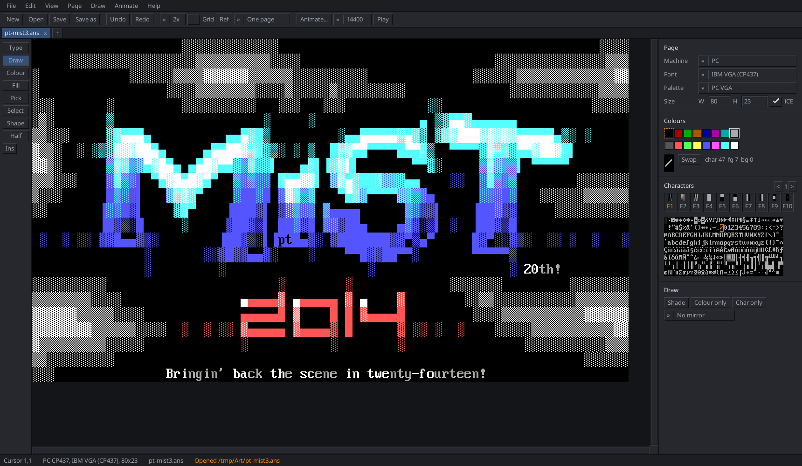
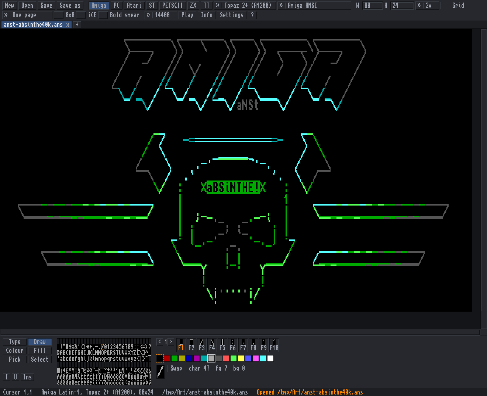
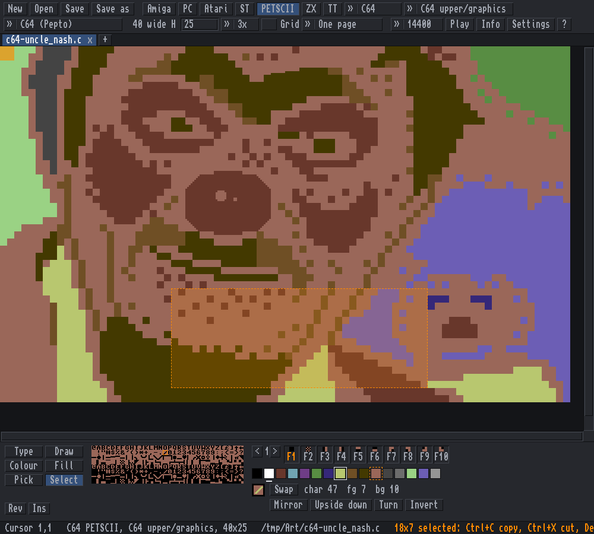
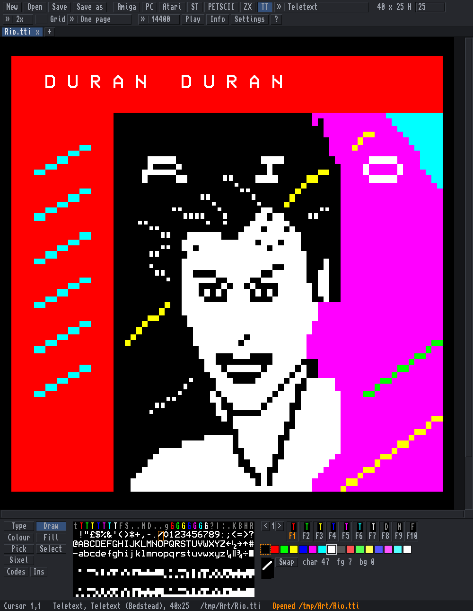
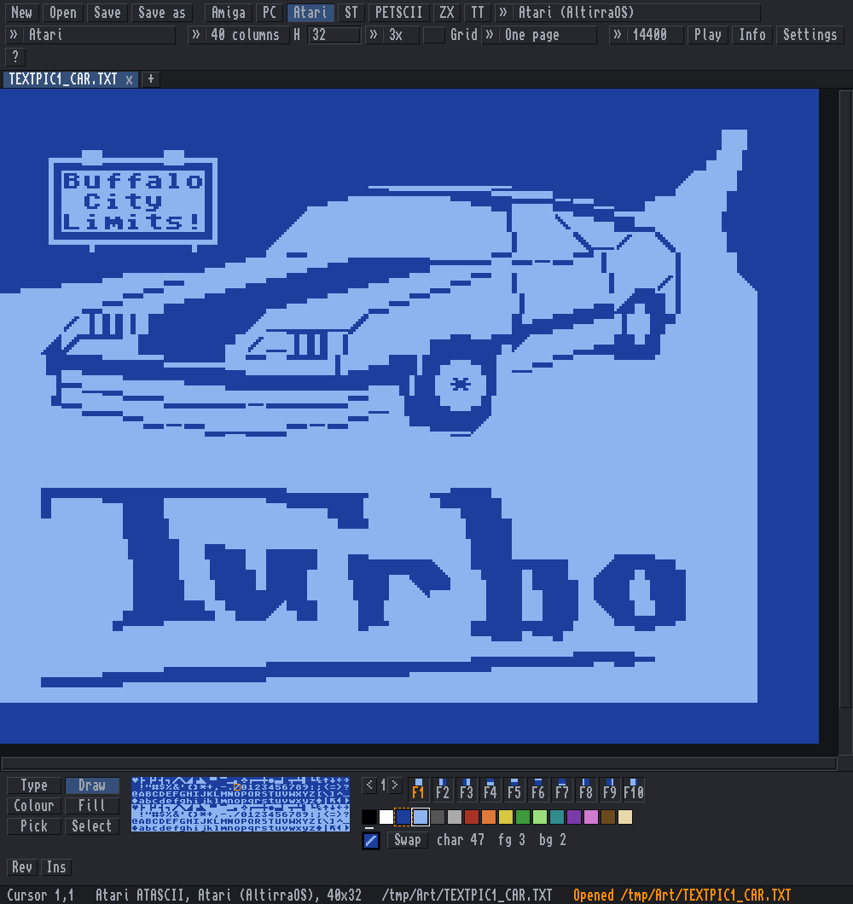
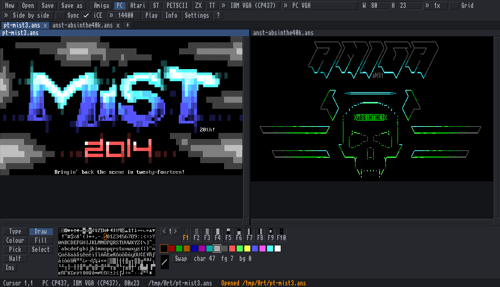
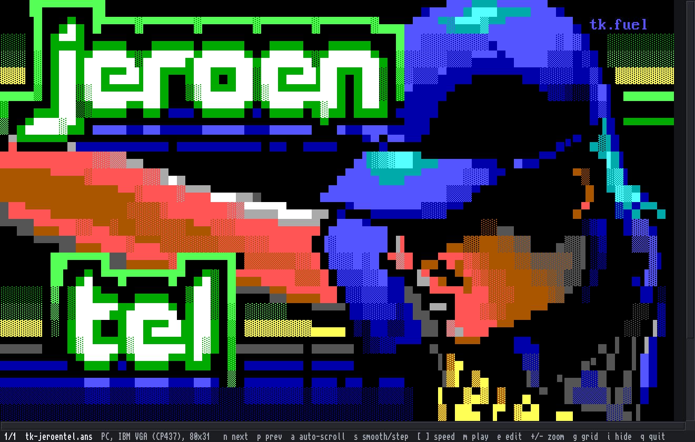
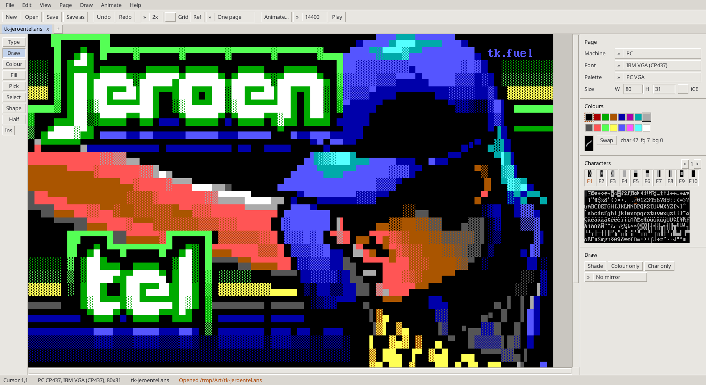
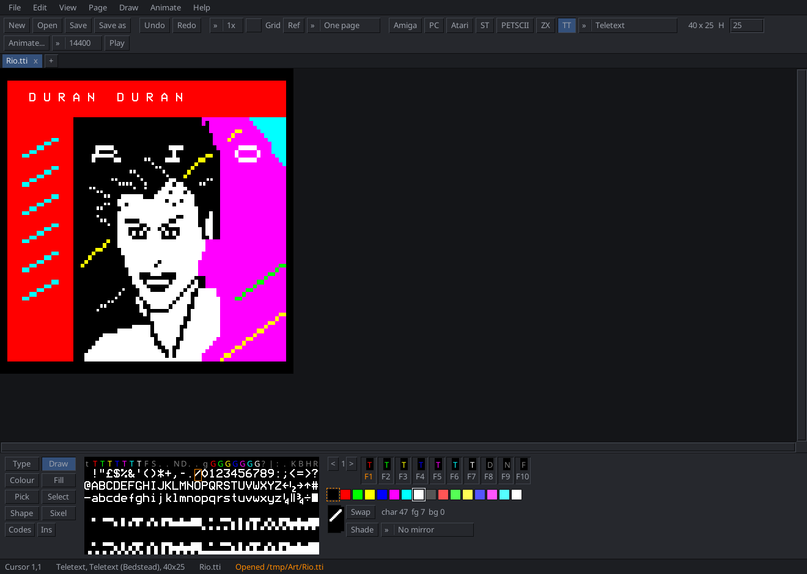
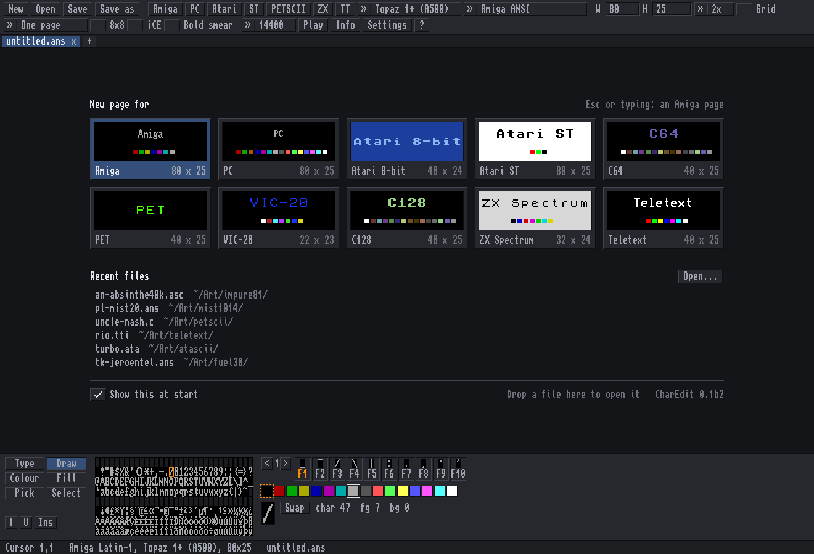

# Charcoal

Drawing with characters: **CharEdit**, the editor, and **CharView**, the viewer, for text art on every
platform: Amiga, PC, Commodore, Atari, Atari ST, ZX Spectrum, Amstrad CPC, MSX, Sharp MZ-700, teletext, Viewdata and Minitel, each with its real font, colours
and file formats.

*MiSTiGRiS 20th Anniversary* by Platinum / MiSTiGRiS (2014), from the mist1014 pack on 16colo.rs.

| | |
|---|---|
|  |  |
| Amiga page in Topaz 2+, the Workbench theme, the Animate menu open: *aBSiNTHE 40K* by aNACHRONiST / iMPURE!ASCII1940 (2022), impure81 on 16colo.rs. | C64 PETSCII with a block selected (Mirror, Upside down, Turn, Invert): *Uncle Nash*, an example picture from Marq's PETSCII editor. |
|  |  |
| Teletext (BBC Micro Mode 7 / Ceefax): *Rio*, an example page from QTeletextMaker. | Atari 8-bit ATASCII: *Turbo* (TEXTPIC1_CAR), from the ATASCII collection at breakintochat.com. |
|  |  |
| Tabs, and two pages side by side (Ctrl+L). | CharView, the viewer: *Jeroen Tel* by The Knight / Fuel (2019), fuel30 on 16colo.rs. |
|  |  |
| The Light theme: *Jeroen Tel* by The Knight / Fuel (2019), fuel30 on 16colo.rs. | The Focus layout (the page as wide as the window, the gadgets under it) on a teletext page: *Rio*, from QTeletextMaker. |

The start screen: a new page for each machine, drawn in its own font and colours, and the recent files.

The art belongs to its artists and is shown here with their names; if you are one of them and want your
piece taken down, open an issue.

## Contents

[Download](#download) · [What it is](#what-it-is) · [Machines](#machines-and-pages) ·
[Features](#features) · [Keys](#keys) · [Build](#build) · [The manual](#the-manual) · [Licences](#licences)

## Download

Get the newest version from the [releases page](https://github.com/creep-ltx/charcoal/releases) ("Assets" under
the top release), unpack the zip and start it. What is new: [CHANGELOG.md](CHANGELOG.md).

| System | File | Start |
|---|---|---|
| Windows 10 / 11 (64-bit) | `charcoal-windows-x64.zip` | `charedit.exe` (drop files on `charview.exe` to view). "Windows protected your PC": **More info**, **Run anyway** |
| macOS 11+ (Apple Silicon and Intel) | `charcoal-macos.zip` | drag **Charcoal.app** to Applications; the first time: System Settings > Privacy & Security > **Open Anyway** |
| Linux (64-bit) | `charcoal-linux-x64.zip` | `./charedit` (needs SDL2, which most desktops have) |

Step by step, the Mac's Cmd and Option keys and where settings are kept: [Installing](docs/manual/install.md).

## What it is

    charedit [FILE...]          # the editor: its own window, one tab per file
    charview FILE|FOLDER...     # the viewer: n / p next and previous, q quits

**CharEdit** draws text art the way each machine showed it: its real bitmap fonts (Topaz, MicroKnight,
P0T-NOoDLE and mO'sOul on the Amiga, IBM VGA and EGA on the PC, the C64's two character sets ...), its colours
and its file formats, or a font of your own made in the font editor. **CharView** is the same program as a
viewer: the art fills the window, a folder plays as a slide show, `a` scrolls by itself, `m` plays the file at
modem speed ([CharView](docs/manual/viewer.md)).

One native program (Go + SDL2) for Windows, Mac and Linux. Every command is in the menu bar with its keys
beside it. Two layouts (**Studio**: tools left, panel right; **Focus**: the page as wide as the window), three
themes (**Dark**, **Light**, **Workbench**), any interface font.

## Machines and pages

Each page type keeps its machine's size, font, colours and rules. Click a machine for everything about it.

| Machine | Page | Files it opens and saves |
|---|---|---|
| [Amiga](docs/manual/pc-amiga.md#amiga-page) | Latin-1 ANSI, Topaz and friends, the console's bold and italic | `.ans` `.asc` `.txt`, SAUCE |
| [PC](docs/manual/pc-amiga.md#pc-page) | CP437 ANSI, iCE colours, 9-pixel cells, VGA / EGA / 80x50 fonts | `.ans` `.bin` `.xb` `.pcb` `.avt`, BBS colour codes, SkyPix `.spx` |
| [Unicode](docs/manual/unicode.md) | terminal and IRC art: blocks, sextants, Braille, 256 and 24-bit colours, wide characters | UTF-8 ANSI, durdraw `.dur`, mIRC `.irc` |
| [Commodore](docs/manual/commodore.md) | PETSCII on PET, VIC-20, C64, C128, Plus/4; C64 multicolour and ECM; DirArt | `.seq`, `.prg`, `.d64`, Image BBS codes, `.ctm` |
| [Atari 8-bit](docs/manual/atari.md#atari-8-bit-page-atascii) | ATASCII, GTIA colours | `.ata`, `.xex`, `.atr` |
| [Atari ST](docs/manual/atari.md#atari-st-page-vt52-and-igs) | VT52 in low, medium and high resolution; IGS graphics | `.vt`, `.ig` |
| [Teletext](docs/manual/teletext.md#teletext-page) | BBC Mode 7 / Ceefax, attributes, sixels | `.tti`, `.ep1`, edit.tf links |
| [Viewdata](docs/manual/teletext.md#viewdata-page) | Prestel, Telstar and today's Viewdata boards | `.cpt`, `.bin`, Telstar `.json` |
| [Minitel](docs/manual/teletext.md#minitel-page) | the French Minitel's Videotex | `.vdt` |
| [ZX Spectrum](docs/manual/machines.md#zx-spectrum-page) | ink, paper, bright, flash | `.scr`, `.tap` |
| [Amstrad CPC](docs/manual/machines.md#amstrad-cpc-page-amscii) | AMSCII in modes 0, 1 and 2 | `.bin`, `.dsk` |
| [MSX](docs/manual/machines.md#msx-page) | SCREEN 0, SCREEN 1, 80 columns | `.rom`, `.bin` |
| [Sharp MZ-700](docs/manual/machines.md#sharp-mz-700-page) | both character sets, 8 colours | `.mzf` |

The files marked `.prg`, `.xex`, `.tap`, `.bin`, `.rom` and `.mzf` are programs: they run on the real machine
or in an emulator and show the page.

## Features

**Drawing** ([Drawing and editing](docs/manual/editing.md))
- Tools: Type, Draw, Colour, Fill, Pick, Select (copy, cut, paste, stamp, move), Shape (line, box, ellipse), Half blocks, Sixel, Shade brush
- Mirror drawing, colour only / character only, flip, turn and invert blocks with the characters' mirror twins
- Tabs, two pages side by side, grid, zoom 1x-8x, undo and redo
- A reference picture to trace over
- Autosave and crash recovery, `.bak` on save, recent files

**Frames and layers** ([Frames and layers](docs/manual/frames-and-layers.md))
- Frames with hold times, onion skin, play; ANSImations open as frames
- Layers: show, hide, lock, merge, black that shows below; layers in every frame

**Fonts** ([Fonts](docs/manual/fonts.md))
- Built-in fonts for every machine, your own fonts (PSF, `.fnt`, `.64c` ...), a pixel font editor
- TheDraw fonts: the Logo tool types logos, a font list with previews, Roy/SAC's 3,536 fonts on request, and a TheDraw font editor

**Files** ([Saving and file formats](docs/manual/formats.md))
- ANSI, UTF-8 ANSI, text, XBin, PETSCII, C64 programs and disks, PNG, web pages, animated GIF and APNG
- Other editors' files: iCEDraw, ArtWorx, TundraDraw, IcyDraw, PabloDraw, TheDraw, REXPaint, Playscii, Marq's PETSCII editor, Petmate, CharPad, TED Screen Editor
- Opens Moebius files exactly as Moebius shows them

**Animation for BBSes** ([Animation](docs/manual/animation.md))
- Templates: TheDraw's 14 patterns plus Matrix rain, Decrypt, Drop, Assemble, Melt in, Power on ...
- Small, medium and large detail; the file's size and what a caller waits at each modem speed, before you save
- Pause codes for Ami-Express, Mystic, PCBoard, Synchronet, Tempest, FAME, CNet, Image BBS and C*Base
- Animate a whole folder of screens in one go, with random versions the board picks from (also from the command line)

**For compos** ([For compos](docs/manual/compos.md))
- Checks the page against Revision, Evoke, Lovebyte, Zoo, Deadline, X, Logiker's and the Teletext Advent Calendar rules
- Writes the files a compo wants, and the work stages

**Drawing together** ([Drawing together](docs/manual/sessions.md))
- Join or host Moebius drawing sessions, with Moebius and IcyDraw users, chat included

## Keys

The common ones; **Help > Keys and mouse** (F12) lists them all. Every key can be changed, and **Settings > Keys
like** gives Moebius, PabloDraw, TheDraw or ACiDDraw keys ([Keys](docs/manual/keys.md)).

| Keys | Action |
|---|---|
| Ctrl+O, Ctrl+S, Ctrl+Shift+S | open, save, save as |
| Ctrl+T, Ctrl+W, Ctrl+Tab | new page, close page, next page |
| Ctrl+Z, Ctrl+Y | undo, redo |
| Alt+T, D, K, L, P, S | tools: Type, Draw, Colour, Fill, Pick, Select |
| Ctrl+0-7, Alt+0-7 | foreground, background colour |
| Ctrl+G, Ctrl+L, Ctrl+H | grid, two pages, hide the gadgets |
| Alt+N, Ctrl+P | new frame, play |
| Alt+J, Alt+G | Animate, Logo tool |

## Build

    make                      # needs Go and the SDL2 development files
    sudo make install         # charedit, charview, menu entries and icon under /usr/local
    make test

Windows and Mac builds, installing for one user, how it is tested and what each source file holds:
[Building and the source](docs/manual/building.md). Working on Charcoal: start with
[docs/HANDOFF.md](docs/HANDOFF.md) and [docs/roadmap.md](docs/roadmap.md).

## The manual

[docs/manual](docs/manual/README.md) has every feature in full: [Installing](docs/manual/install.md) ·
[Drawing and editing](docs/manual/editing.md) · [Keys](docs/manual/keys.md) · [CharView](docs/manual/viewer.md) ·
[PC and Amiga](docs/manual/pc-amiga.md) · [Unicode](docs/manual/unicode.md) · [Commodore](docs/manual/commodore.md) ·
[Atari](docs/manual/atari.md) · [Teletext, Viewdata, Minitel](docs/manual/teletext.md) ·
[Spectrum, CPC, MSX, MZ-700](docs/manual/machines.md) · [File formats](docs/manual/formats.md) ·
[Frames and layers](docs/manual/frames-and-layers.md) · [Fonts](docs/manual/fonts.md) ·
[Animation](docs/manual/animation.md) · [For compos](docs/manual/compos.md) ·
[Drawing together](docs/manual/sessions.md) · [Building](docs/manual/building.md) · [Licences](docs/manual/licences.md)

## Licences

Charcoal is under the MIT licence (`LICENSE`), copyright Tobias Karlsson. The fonts, libraries and test files
keep their own licences, listed in [Licences](docs/manual/licences.md); the copies are in `fonts/`,
`third_party/` and, in the downloads, `licences/`. Machine ROMs that may not be passed on are not included:
CharEdit fetches the free ones on first use, or uses yours.
